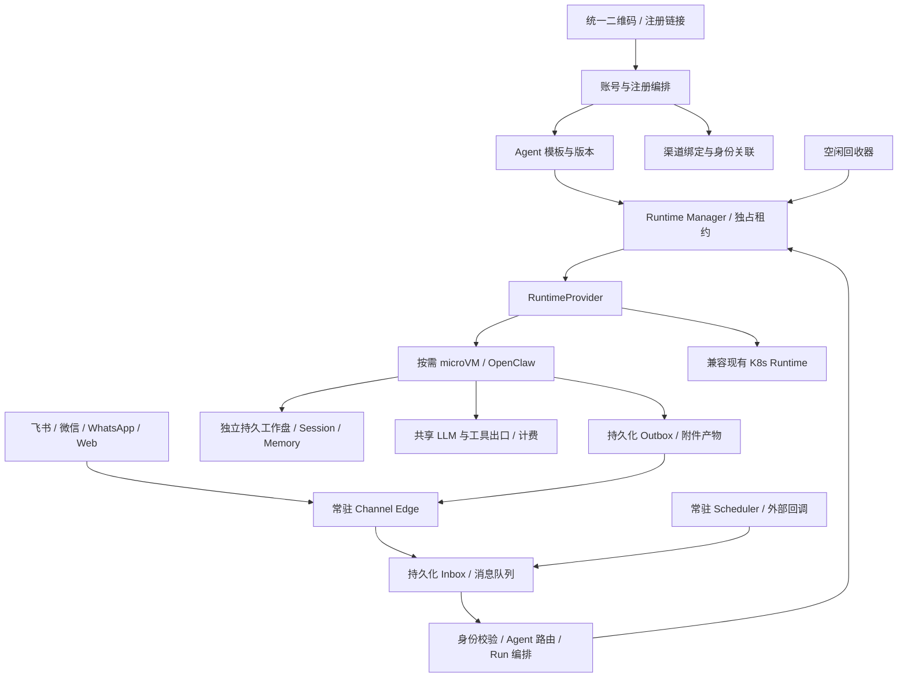

# Nexus 多渠道、多 Agent、弹性运行平台方案

日期：2026-09-14。状态：架构提案，完成 Vercel 基础设施短时测试；业务改造尚未实施或部署。

代码基线：`master / e2af898892bd58caa2a78937c69114b88c240a3c`。
本地方案分支：`codex/nexus-elastic-agent-plan`。

## 1. 推荐方向

把 Nexus 从“为每个 Agent 分配常驻 Pod”演进为“长期保存 Agent 身份和数据，按需分配计算实例”的平台。

- 一个固定二维码进入注册入口，选择 Agent 产品和渠道；同一账号可以创建多个 Agent，也可以为同一个 Agent 追加渠道。
- DealClaw、Mirror V、星擎分别成为版本化 Agent 模板。模板定义能力和运行要求，用户实例保存自己的配置、记忆和业务数据。
- 渠道连接、可靠消息收发、定时唤醒、计费和调度常驻；完整 Agent 运行在按需创建或恢复的 microVM 中，空闲后释放 CPU/内存。
- **用户已选定先用 Vercel 跑通，区域后续优化。** 用已有 Makaron Vercel 账号建立独立 Nexus 验证环境；通过统一 RuntimeProvider 接口保留 E2B / 国内自建 microVM 的替换能力。
- **第一阶段先验证真实 OpenClaw 恢复速度、会话连续性和空闲释放。** 供应商正式选型以这项验证为门槛，不能因为二维码或页面做完就认为核心改造完成。

首轮沿用已验证可访问的 Vercel 资源建立完整闭环，不以国内宿主采购或多区域部署为前置条件。随后比较香港/新加坡等区域与主要客户数据位置。区域优化同时约束数据库、工作盘、快照和模型出口，不能只切 VM region；存在特定数据驻留要求的客户单独处理。

## 2. 已核对的现状

以下是当前代码事实，不是线上集群盘点：

| 项目 | 当前实现 | 对改造的影响 |
|---|---|---|
| 租户计算 | Agent 默认 requests 1 CPU / 2 GiB，limits 2 CPU / 4 GiB；另有 Gateway requests 0.2 CPU / 256 MiB | 用户对 1 核 2G 的理解基本正确，但每租户实际预留还包含 Gateway |
| 租户资源 | 每租户 namespace、Agent Deployment、Gateway Deployment、Service、Secrets、PVC | `tenantId` 与运行资源强绑定，需要解耦 |
| 工作盘 | 配置默认 PVC 100 GiB，`/data` 持久化 | 100 GiB 是声明容量，不代表实际使用或实际账单；迁移先量实际数据 |
| 渠道 | `/onboard` 已有 UA 分流；飞书有编排，钉钉/企业微信有指南或占位回调；微信绑定通过 Agent 内插件 | 有一个码的雏形，不等于所有渠道已能注册并正常通信 |
| 消息面 | 同时存在 Gateway 转发、Agent 内 OpenClaw 飞书/微信直连、Web API/SSE | 停掉 Agent 内连接就失去下一条消息入口；旧 Gateway 转发也不是可直接交付的渠道层 |
| Agent | Dockerfile 固定 OpenClaw 2026.7.1，payload 内 118 个 SKILL.md；存在独立 2026.9.1 分支 | Runtime、业务 payload、版本升级需要分开管理 |
| 启动 | entrypoint 同步 payload、生成配置、处理插件安装/登录、启动 Gateway、注册 cron | 完整启动工作不能全部留在每次唤醒路径 |
| 会话 | `/execute`、`/execute/stream` 经 OpenClaw `/v1/responses`；部分日志是 fire-and-forget | 可作 RuntimeAdapter 起点，但不能作可靠任务和会话存储的全部依据 |
| 后台任务 | 每租户 runtime 注册日报、邮件轮询、推荐、反思 cron | 休眠后这些定时任务也消失，必须外置 |

代码入口：

- [资源开通](../../packages/provisioning-service/src/services/provisioning.ts)
- [当前数据库迁移](../../packages/provisioning-service/src/db/migrate.ts)
- [注册入口](../../packages/central-gateway/src/app.ts)、[飞书编排](../../packages/central-gateway/src/services/onboarding-orchestrator.ts)
- [Agent bridge](../../packages/dealclaw-agent/src/app.ts)、[OpenClaw adapter](../../packages/dealclaw-agent/src/openclaw-runtime.ts)
- [启动脚本](../../packages/dealclaw-agent/runtime/entrypoint.sh)、[镜像](../../packages/dealclaw-agent/Dockerfile)

开发基线：依赖已安装；前一轮 10 个包中 7 个构建通过，Gateway / Credits / Provisioning 遇到 Buffer 类型兼容错误；Agent、Gateway、Mock Agent 的 61 项测试通过。这不能替代数据库、原生渠道和线上验收。

## 3. 目标架构



上述是逻辑边界，不要求一开始部署十几个服务。首版将注册/模板 API 放入现有 Provisioning，将 Router、Runtime Manager、Scheduler 放入一个常驻 Worker 服务；Channel Edge 独立，便于保持连接和扩容。数据库先复用 PostgreSQL 技术栈，开发及实验使用独立数据库。

**不会消失的资源**：共享接入/控制服务、数据库、用户存储、少量预热实例。释放的是每个闲置 Agent 的专用计算资源。渠道长连接本身仍有成本，但不需要为每个连接附带完整 OpenClaw。

## 4. 二维码与渠道注册

二维码编码稳定 HTTPS 入口，例如 `/join/<registration-entry>`，不编码密钥、一次性授权码或 VM 地址。入口配置允许的模板、渠道、套餐、有效期和推广来源；已经印出的二维码无需随版本升级更换。

用户流程：扫码 → 选择/确认 Agent → 选择渠道并完成该渠道原生授权 → 获得长期 Agent 身份 → 发送消息。第一次创建 Agent 只写持久配置，允许异步预热，注册成功不依赖永久占有机器。

支持两种明确动作：`create-agent` 和 `bind-existing-agent`。追加渠道需要已登录的 Nexus 所有者授权或一次性安全绑定挑战。飞书 open_id、微信身份、WhatsApp 手机号不能按昵称、头像、同名公司自动合并。注册请求带幂等键，重复扫码/回调不重复创建 Agent。

UA 只用于推荐渠道，页面始终允许用户切换。微信扫码、飞书应用创建、WhatsApp WABA 授权是不同原生流程；“一个码”指统一入口，不承诺一个授权自动开通所有平台。

| 渠道 | 现有基础 | 建议范围 |
|---|---|---|
| 飞书 | 扫码创建应用、官方插件和 WS 路径 | 首批；先做完整接收、流式卡片、附件、回复、互动回调 |
| Web | 管理后台聊天、外部 API/SSE | 第一条弹性运行验证链路；随后提供普通用户入口 |
| 微信 | 插件与扫码 bridge 已存在，登录发生在 Agent 内 | 首批产品目标；先验证登录态/轮询可迁出，未完成前不宣称支持休眠 |
| WhatsApp | 独立 bridge，已有多租户逻辑 | 第二批接入，绑定与回调归一化；沿用对应平台发送限制 |
| 钉钉 / 企业微信 | 导航/指南/占位回调 | 适配合同预留，完整授权和收发验收后才展示“可用” |

Channel Edge 复用上游渠道适配能力，保留原生卡片和工具反馈，避免把现在的流式体验降级成只转发纯文本。连接按 binding 分片，同一 binding 一个连接 owner，以租约和 fencing epoch 防止两个节点重复消费。Webhook 在消息持久化成功后快速 ACK；不把 Agent 执行绑在平台回调的超时窗口内。

## 5. Agent 模板、用户实例、运行实例

三者必须区分：

| 对象 | 含义 | 生命周期 |
|---|---|---|
| AgentTemplate / TemplateVersion | DealClaw、Mirror V、星擎的可发布能力包 | 版本化、可复用 |
| AgentInstance | 某客户自己的某个 Agent，稳定 agent_id | 长期存在，休眠不改变身份 |
| RuntimeLease / Execution | 此次分配的 VM、运行位置和 Run | 可恢复、可替换、可回收 |

一个 Customer 可拥有多个 AgentInstance；一个 AgentInstance 可绑定多个 ChannelBinding。默认同一 Agent 的多渠道共用其工作空间与允许共享的长期知识，但每个渠道会话分区独立。跨渠道合并同一会话需要显式身份确认和会话关联，群聊不能自动继承私聊上下文。

首版采用 **一个 AgentInstance 同时最多一个可写 runtime**；同一会话的 turn 串行。不同 AgentInstance 可以并行。之后支持模板内团队 Agent/Subagent，由同一运行时管理会话与工作空间权限；不把几个互不信任客户装进同一个 OpenClaw 来凑“多 Agent”。

配置拆为：

1. `runtimeImage`：固定 digest 的 OpenClaw/其他引擎、Node/Python、系统依赖、插件；不含客户数据。
2. `payload`：身份模板、Skills、流程、可分发知识种子；固定 digest，构建时校验兼容性。
3. `instanceConfig`：客户定制、语言、模型策略、启用能力、资源规格、空闲期限。
4. `secretRefs`：平台运行时按需签发或代理，模板只存引用，不复制供应商/客户密钥。
5. `state`：会话、任务、记忆、文件、业务连接状态；独立于镜像版本。

示例合同见 [模板配置示例](./nexus-agent-template.examples.json)。这只是设计样例，不是已实现 API。

### Mirror V 的接入

本机 `/Users/tianyicai/v-core` 已有 `mirror-v-build-payload.py`、`mirror-v-apply-identity.py`、`mirror-v-new.py`，可选择 memory/skill bundle，生成带 archive SHA 的 manifest，并覆盖实例身份。

将这条流程变成 `VCore source revision → 可分发清单 → Payload Registry → Mirror V TemplateVersion → 用户实例`。现有 SSH 部署脚本保留给独立部署客户；Nexus 新建 Agent 不再依赖脚本先建 Lighthouse 主机。

旧生成器默认 `v001-full`，旧实例工具存在默认注入完整 runtime keys 的路径；**不能原样作为 SaaS 模板默认值**。Nexus 导入时重新建立显式可分发清单，仅允许批准的 Skills、通用人格和知识种子。私人 V 的会话、浏览器 profile、OAuth、私有用户画像、全量记忆及运行环境不进入公共模板。客户迁移已有镜像时，数据走该客户独立迁移通道。

星擎目前按一个新 Template 预留；尚未在本轮核验其代码仓库/运行合同，不把现有 DealClaw 改名就当接入完成。若依赖 Makaron 内容生产，可通过有作用域的工具 API 调用，不必将媒体渲染环境全部塞入基础 Agent 镜像。

## 6. 按消息唤醒与空闲释放

逻辑状态：`SLEEPING → WAKING → READY → BUSY → IDLE → QUIESCING → CHECKPOINTING → SLEEPING`；异常进入 `RECOVERING/FAILED`，与租户欠费/停用等业务状态分开。

消息处理顺序：

1. Edge 验证来源，解析 channel binding、租户和用户；用平台 event ID 去重，写 durable Inbox。
2. Router 校验权限和额度，确定 agent_id / conversation_id，创建或复用 Run。数据库是任务事实来源，内存 Map 不能承担可靠队列。
3. 获取该 Agent 的独占 writer lease，产生单调递增 epoch。已有 READY/BUSY 实例则复用；WAKING 时后来的消息排队，不重复创建 VM。
4. 按固定模板版本、数据区域和资源 profile 创建或恢复实例。挂载工作盘，恢复 Session/Memory，刷新租约与短期 token，启动并探测实际 runtime。
5. 只有 Agent readiness 通过后才提交消息。SSE 按 `run_id + sequence` 持久记录可重放事件；原生渠道回复由 Outbox 送达。
6. Run 结束且用户状态已持久化后释放 active pin，进入 IDLE。后续消息复用当前实例。
7. 默认空闲 10 分钟，模板可在 2–30 分钟之间配置；高频用户可调整为常驻，低频工作型 Agent 可用更短 TTL。
8. 回收器用 CAS 进入 QUIESCING，停止分配新 turn，检查活跃 Run/工具/子进程/未提交状态，flush 并 checkpoint。新消息若在回收前到达可取消回收；已在 checkpoint 时则保持队列并等待完成后恢复。
9. 停止或暂停实例；只有 Provider 确认 CPU/内存已释放后才记为 SLEEPING，保留稳定 Agent 身份、工作盘和任务状态。

“空闲”不等于没有聊天输入。LLM 正在生成、工具执行中、子 Agent 活跃、文件上传/持久化中都不能被回收。等待人类审批可在持久化 continuation 后休眠；恢复时重新校验审批，不维持一个等用户答复的计费 VM。模型网络等待期间虽然可能不计 CPU，但仍占内存。

### 外部任务与异常

- cron / Heartbeat / 邮件轮询迁到常驻 Scheduler，到点写入同一个 Inbox。外部视频生成提交后保存 provider task ID，释放不必要的 runtime；回调/定时检查再唤醒。
- 调度带抖动、限流与并发上限，避免所有客户同一时间日报、反思导致启动风暴。
- 消息、工具、计费、回复分别有幂等键。采用至少一次投递加去重，不承诺跨第三方服务的神奇 exactly-once。
- 工具已产生外部副作用但本地未收到 ACK 时，先查询 provider operation ID/结果再决定重试。无幂等和查询能力的发送/支付类工具转人工核对，不能自动重放。
- lease 过期不等于旧 VM 已停：失联旧实例必须先完成存储/出口 fencing 或确认终止，才允许新 writer 挂盘；否则进入恢复等待，避免双写。
- Outbox 已持久接管的消息可以在 Agent 休眠后继续发送；尚只在进程内的最终回复不允许随着实例被销毁。
- 自建宿主/托管 VM 都可能故障。对运行中的同步写入设置持久化边界，不把“优雅停止时才快照”当成崩溃容灾。

## 7. 数据与升级

首版兼容现有文件模型，保留每 Agent 私有 `/data`，将身份与业务文件、OpenClaw sessions、memory 索引分区。不要在唤醒时下载整个 100 GiB workspace；采用可挂载持久盘，或有版本清单的增量 hydration。迁移前测热数据集大小、SQLite/文件锁及落盘语义。

控制数据库保存 Agent、binding、Run、审批、Inbox/Outbox、计费事件、runtime lease、最后有效 checkpoint 和版本；现有展示用 chat_messages 不是完整 OpenClaw 恢复记录。对象存储保存不可变 payload、附件、归档和备份。供应商快照是恢复加速手段，客户重要状态另有可恢复备份。

Vercel 路线可验证独立 Drive 承载 `/data`，基础镜像负责工具链。Drive 目前为 Beta，且同一 Drive 仅一个读写挂载；必须先实测 SQLite、文件锁、flush、故障恢复和升级换镜像。若不能满足生产要求，则使用已验证的持久盘 Provider，不能用未经验证的对象存储 FUSE 代替 POSIX 盘。[Vercel Drives](https://vercel.com/docs/sandbox/concepts/drives)

基础模板快照不含任何租户凭据或数据，可供预热池复用。租户磁盘/内存快照只供该租户恢复，不能放回公共预热池。租户历史快照里可能包含已过期 token，恢复钩子重新绑定身份、网络、时钟和权限。

模板更新产生新版本，不覆盖正在运行的配置。运行空闲后提交 state checkpoint，挂原私有盘启动新镜像；runtime/state schema 不兼容时先迁移到副本并验证。回滚以带版本的 state 备份为依据，不能只回滚镜像而忽略新版本写入的数据。第一阶段禁止新 runtime 与旧 Pod 同时持有写权限。

## 8. RuntimeProvider 选型

截至本次查看的官方文档：

| 方案 | 适配点 | 限制与决定 |
|---|---|---|
| Vercel Sandbox | 已有账号和真实使用基础；支持自定义 OCI 环境、持久 sandbox、SDK 唤醒、独立 Drive | **首个 PoC Provider**。持久 sandbox 恢复是新的 VM session，从保存的文件系统起步，需要重启服务；不按内存恢复估时。Drive/VCR Beta 和中国网络路径需验证 |
| E2B Cloud / 合适的 BYOC | 支持内存和磁盘一起 pause/resume，更接近 OpenClaw 热恢复 | 当 Vercel 实际 Agent 恢复达不到目标时优先对照验证；账号、区域、价格及业务运行要求另验 |
| 自建 E2B / Firecracker | 可用自己的 Linux/KVM 宿主控制区域、存储与密度 | 国内规模化候选。当前没确认可用 KVM 宿主；单机 Embed 是评估包，生产 HA、网络、盘、调度和运维需独立设计 |
| 现有 K8s | 现有租户兼容与灰度回滚容易 | 保留 legacy Provider。scale-to-zero Pod 可验证调度，但普通 Pod 不是 VM，也不能证明 microVM 唤醒速度 |

Vercel 当前文档支持自定义 OCI 镜像，但要求 VCR 优化就绪；现有私有 ACR 镜像不能直接假设可拉取。自定义镜像的 ENTRYPOINT/CMD 不自动执行，Adapter 必须显式启动 Agent。Makaron 依赖仍为 `@vercel/sandbox ^1.9.3`，而当前文档已有新版本合同，Nexus 单独固定 SDK 和兼容测试，不能直接修改 Makaron 的生产依赖或 Snapshot。[Images](https://vercel.com/docs/sandbox/concepts/images)、[Persistence](https://vercel.com/docs/sandbox/concepts/persistent-sandboxes)

E2B 的默认 pause 保存进程内存和磁盘；文件系统恢复模式则重新启动。应用仍需处理已断开的 TCP、过期 token 和跨暂停时间的定时器，不能把内存快照视为业务续跑保证。[E2B persistence](https://docs.e2b.dev/sandbox/persistence)

自建 Firecracker 需要宿主暴露 KVM；E2B Embed 提供 Compose / K8s 等单机评估形态，不是开箱即用生产集群。[E2B Embed](https://github.com/e2b-dev/runtime/tree/main/embed)、[Firecracker](https://firecracker-microvm.github.io/)

**长期采用哪家不影响产品合同**：模板、Agent 身份、渠道和长期数据不绑定 VM ID；但换区域/换 Provider 涉及盘格式与数据迁移，应按计划停写迁移，不能写成无成本的瞬时跨云漂移。

## 9. 本轮资源核验与实验落点

资源盘点采用读操作；另在用户授权使用 Makaron 资源及选择 Vercel 后，进行最多 3 个顺序执行的独立短时 Sandbox 基线测试，每个限制 1 vCPU / 2 GiB、120 秒、deny-all 网络，用后停止并复查状态。没有迁移生产租户或改变现有资源配置。

| 资源 | 本轮证据 | 用途判断 |
|---|---|---|
| Makaron Vercel | CLI 登录有效，可读取 ai-image-editor 项目；Sandbox Snapshot API 可读到已创建快照 | 可复用团队/访问方式，实验使用 Nexus 独立命名与独立镜像/快照/盘；新区域和新 SDK 的实际运行仍需 PoC |
| Makaron 源码 | 有 media-sandbox-vercel.ts、snapshot 构建脚本和 finally 回收逻辑 | 复用供应商接入经验，不复用媒体镜像作为完整 V 模板 |
| 本机 GCP | 可列两个 Gemini 项目；两个项目的 Compute API 均未启用 | 当前不能宣称已有 GCE microVM 宿主可用；不因为命令报错就开启 API/创建机器 |
| 本机 K8s | 当前 kubeconfig 无 context | 未核验 Nexus 线上节点、租户数量、资源占用和实际账单 |
| 私有 V | `ssh v` 成功；8 vCPU，约 30.5 GiB 内存；无 `/dev/kvm`；磁盘约 87% 使用 | 可作只读运行参考；不选作自建 microVM 宿主，不与生产 V 争抢内存 |
| Makaron AWS 配置 | 本机发现相关凭据配置键，未调用账户资源 API | 只是凭据存在，不能认定 EC2/IAM 权限或剩余额度；需要时定向核验 |
| Makaron GPU 服务 | 本地规则确认有既有媒体服务边界，本轮未盘点实时实例 | 作为星擎可调用的媒体能力，不为聊天 VM 改造占用或重配置 |

资源授权可直接用于后续范围内实验。方案落点不是“把所有 Key 灌进新实例”，而是平台持有资源权限，给每个 Agent 签发必要的工具/模型访问能力。

### Vercel 基础设施实测

用 Makaron 现有本机 SDK 创建 3 个全新 node24 sandbox，每个 1 vCPU / 2 GiB、120 秒硬超时、deny-all 网络；执行 Node 文件写入/读回，再 blocking stop 并独立查询状态。只处理合成标记，未加载客户数据、模型密钥、业务 payload。

| 次数 | create 返回 | 从 create 开始到首条命令完成 | stop 确认 | 最终状态 |
|---|---:|---:|---:|---|
| 1 | 1034 ms | 2043 ms | 2838 ms | stopped |
| 2 | 1010 ms | 1837 ms | 2720 ms | stopped |
| 3 | 700 ms | 1475 ms | 2868 ms | stopped |

三次文件校验均成功。计时包含 Mac 到控制 API 的网络耗时；没有控制供应商内部缓存，不应称为严格冷启动基准；3 个样本不足以报告 P95。**没有测试 OpenClaw、持久盘、进程恢复或原生渠道。** 当前只能确认 SDK 创建、执行、释放的实际可用性。原始脱敏记录见 [Vercel 基线 JSON](./nexus-vercel-baseline-2026-09-14.json)。

## 10. 启动目标与验收

以下是拟定验收目标，**不是本轮测出的性能**：

| 指标 | 初始目标 |
|---|---|
| 消息到 durable Inbox + 平台 ACK | P95 < 1 秒 |
| 已运行 Agent 的调度额外延迟 | P95 < 300 ms |
| 已预热/恢复实例到 Agent READY | P50 ≤ 1 秒，P95 ≤ 3 秒 |
| 冷创建到 Agent READY | P95 ≤ 10 秒，超出时单独分析镜像、盘、runtime 初始化 |
| 用户首个有效输出 | 分别报告排队、唤醒、上下文准备、模型首 token、渠道送达；不能拿“正在启动”占位当输出 |
| 10 分钟空闲回收 | 无活跃 pin 时，TTL 后 60 秒内释放计算；checkpoint 失败则可见告警与受控重试 |
| 连续性 | 休眠/恢复 100 轮，已提交消息和文件丢失 0，重复收费 0 |

预装依赖、编译产物、插件发现、模板初始化都放到构建阶段。普通唤醒只做私有状态绑定、短期权限刷新和必要服务恢复。按 runtimeImage + payloadDigest + region 维护少量不带客户状态的预热槽位，容量用真实突发调节。

测试至少覆盖三种负载：精简聊天 Agent、真实 DealClaw payload、可分发 Mirror V payload；分别测 1/10/50 个并发唤醒、热缓存/冷缓存、1 小时/24 小时休眠、工具执行中收到第二条消息、恢复后原生卡片交互、文件读写、上下文压缩与 Memory 查询。星擎拿到真实 payload 后补验。先小批量，再通过费用和失败率门槛扩大，避免无意义压测开销。

失败演练：worker crash、Provider create 超时但后台创建成功、重复消息、租约过期但旧 VM 存活、checkpoint 与新消息竞争、旧快照过期、工具副作用 ACK 丢失、对象存储/盘故障。通过资源标签清查孤儿实例，计费以 Provider 实际停止事件为准。

完整产品验收是：同一二维码在至少两种渠道成功注册；同客户拥有 DealClaw 和 Mirror V 两个独立 Agent；其中一个绑定第二渠道；发真实消息唤醒、使用工具、收到完整回复；空闲释放后再次沟通保持正确记忆和文件；另一个客户无法读取这些数据。

## 11. 成本模型

先看占用时间：1000 个 Agent 每天平均需要 30 分钟 runtime（**已经包括空闲保温窗口**），平均同时在线约 `1000 × 0.5 / 24 = 20.8`。这只是均值，不能拿来当峰值容量承诺。若每 Agent 预留 2 GiB，活跃部分均值约 41.7 GiB，再加预热池和共享服务；现状仅 Agent 请求量合计为 2000 GiB，另加每租户 Gateway。

若沿用当前每 Agent 2 GiB + 每 Gateway 0.25 GiB，则 1000 个静态租户声明请求约 2250 GiB。弹性带来的调度占用下降不等于账单立刻等比例下降：自建宿主若数量不缩，主机费仍存在。

Vercel 官方 `iad1` 示例单价：Active CPU $0.128/小时、已分配内存 $0.0212/GB·小时、快照 $0.08/GB·月；其他区域不同。模型等待不计 Active CPU，但运行期间内存继续计费。[价格与配额](https://vercel.com/docs/sandbox/pricing)

示例：1000 Agent × 30 天 × 0.5 小时 × 2 GB = 30,000 GB·小时，内存约 $636/月；若每 Agent 每天累计活跃 CPU 为 3 CPU·分钟，则 CPU 为 1500 CPU·小时，约 $192/月，二者合计约 $828/月。此处不含模型、基础服务、工作盘/快照、流量、套餐、预热、失败重试和税；也不是对现有集群账单的报价。

空闲期限必须按会话簇测量。每天只处理几分钟消息，但分布在十几个时间段，10 分钟保温可能比真正工作耗时更贵。后台展示计算在线时长、活跃 CPU、内存时长、存储、模型用量和每次唤醒成本，提供 auto / always-on 策略。

## 12. 改造模块与顺序

| 阶段 | 具体改动 | 交付门槛 |
|---|---|---|
| P0：弹性运行 PoC | 修通所需构建基线；独立实验目录/环境；Vercel Provider、精简 RuntimeAdapter、私有状态挂载、Run/lease 最小合同 | Web 真实 OpenClaw 对话 → 休眠 → 恢复 → 会话/文件连续；输出分阶段延迟和释放证据。若超标对照 E2B |
| P1：消息可靠性 | Channel Edge（先飞书）、durable Inbox/Outbox、Scheduler、恢复与回收状态机 | Agent 停止时仍能接消息/到点唤醒；流式回复、互动回调、去重和故障演练通过 |
| P2：多模板/多 Agent | Template Registry、实例配置、账号到 Agent 关系、版本固定、Mirror V 导入；共用 Provider 接口 | 同客户两个不同模板实例并存、数据隔离；升级和回滚可恢复 |
| P3：统一注册产品 | 统一入口、原生渠道授权、绑定状态机、Web/微信/WhatsApp 分批适配；普通用户与管理员视图 | 一个码至少两个真实渠道闭环；追加绑定不重复创建 Agent |
| P4：灰度迁移 | legacy mapping、迁移任务、按 Agent 开关、旧/新单 writer 接管、盘兼容与回退 | 少量内部 Agent → 低风险真实租户 → 扩大；达标后才释放对应旧 Pod |

这是依赖顺序，P0/P1 同时定义模板与身份合同，避免先写死 DealClaw 再重构。正式工程排期要在 P0 暴露 OpenClaw 启动与渠道迁移难度后细化。

建议源码布局：

```text
packages/runtime-contracts/      # Provider、Agent runtime、消息、lease 类型
packages/runtime-manager/        # 唤醒、队列消费、idle、reconcile
packages/channel-edge/           # 常驻渠道接入与回复
packages/agent-runtime/          # 通用 Agent bridge，逐步吸收 dealclaw-agent runtime
packages/provisioning-service/   # 增加模板/实例/binding API，保留旧租户 API
packages/central-gateway/        # 改造统一注册入口
packages/admin-web/              # 模板、Agent 实例、渠道、运行状态、成本
packages/credits-ledger/         # 在 customer/agent/run 三层归集，保留现有账务
```

数据迁移增量增加 `agent_templates`、`agent_template_versions`、`agent_instances`、`channel_bindings`、`identity_links`、`registration_entries/sessions`、`agent_runs`、`runtime_leases`、`inbox/outbox`、`scheduled_events`、`state_checkpoints`。字段和唯一索引在实施时形成 migration；不直接把旧 tenants 全量重命名成新 customer。

旧 tenant 先映射到一个默认 DealClaw AgentInstance，通过 `legacy_tenant_id` 对接现有计费/渠道。新 account/customer 与 Agent 的所有权关系独立建立；同一账务客户下多个 Agent 归集到账务客户，不重复赠送额度。现有运行时配置、镜像 promote、rollout、ops-agent 必须识别 runtime_policy，不能把休眠误判故障并自动拉起，也不能向已迁移 Agent 再创建旧 Pod。

## 13. P0 的明确通过/不通过判断

P0 通过后继续：Web 链路上的真实目标 payload 恢复达到双方选定的启动目标；100 轮状态连续性通过；有可核算的资源释放记录；无双 writer、重复收费或重复工具副作用。P1 再以至少一个原生渠道证明停止时可接入并唤醒、完整回复和互动回调通过；这也是任何生产迁移的必要条件。

若 Vercel 文件系统恢复需要长时间重新启动 OpenClaw：比较 E2B 内存恢复和预热池，不用增加“启动中”文案掩盖。若国内网络路径不可接受：保留国内 K8s 租户，另在确认 KVM 的国内宿主验证 Provider。若状态无法安全恢复：先修状态协议，不扩大用户范围。

本轮交付的是经过代码和资源核验的方案，以及 3 次基础 Sandbox 创建/执行/停止的实测。尚未创建 Nexus 专用云项目、完成真实 Agent 恢复性能测量、核验线上租户账单、实施渠道迁移或发布任何功能。
