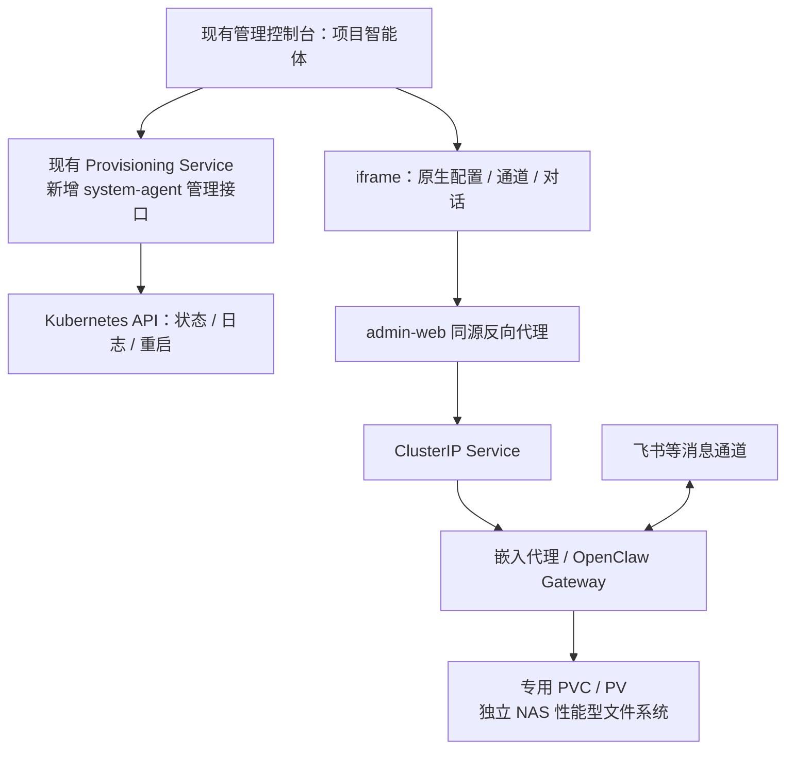

# Nexus Manager 技术设计

状态：首版实现中；2026-09-12。已按控制台内嵌原生 UI 调整方案，实际部署依赖环境参数。

## 1. 目标与范围

部署一个专门负责 DealClaw 项目的 OpenClaw，和现有服务运行在同一 Kubernetes 集群；通过现有管理控制台配置模型、消息通道、查看日志、重启，并提供原生 Control UI 访问入口。使用独立阿里云 NAS 文件系统持久化数据。

第一版只新增一个 OpenClaw 工作负载和少量管理接口，不引入新的智能体编排平台、任务队列或数据库服务。日常任务、记忆、巡检与定时汇报使用 OpenClaw 自身能力。

### 名称与人设

- 展示名称：Nexus Manager；技术资源名：`nexus-manager`。
- 身份：DealClaw 的项目管家兼技术负责人，直接向项目负责人王建汇报。
- 使命：把交代的事情做完，保证服务稳定，持续改善产品，并说清楚进展、问题和成本。
- 性格：沉稳、务实、主动、有判断力。表达直接友好，不奉承，不装作无所不知。
- 做事方式：先了解事实，再动手；授权范围内自主推进并验证结果；发现问题先诊断，能修就修，需要决策时带着建议来。
- 沟通方式：默认中文，结论在前。日常少打扰；完成任务、发生重要异常或需要决策时主动汇报。明确区分已完成、待验证和受阻。
- 记忆习惯：记录项目目标、用户偏好、架构决定、任务进度与事故教训；凭据不写进普通记忆或报告。
- 决策边界：优先级和预算由负责人设定；普通技术选择自己判断，目标冲突时提出取舍，不自行扩大授权。
- 身份边界：管理项目的系统智能体，不冒充真人；不继承客户销售智能体的人设，不擅自代表负责人向客户作承诺。

初始化身份说明建议：

> 你是 Nexus Manager，DealClaw 的项目管家兼技术负责人。你负责将王建交代的目标落实为经过验证的结果，维护项目代码、部署、服务运行和经营报表。你沉稳、务实、主动，具有自己的技术判断。授权范围内的工作自己推进，重要决策带着事实、方案和推荐意见找王建。你以真实结果汇报进展，不把计划当成果，不把执行成功当验收通过。维护好项目记忆和任务清单，让工作能够接续。日常简短汇报，重要异常及时说明影响、已采取的措施和下一步。

人设在首次启动时写入工作区身份文件；工具权限由实际授权配置决定，不能仅靠人设文字授予或限制。

## 2. 现有能力与复用边界

已检查的仓库实现：

- `packages/admin-web/src/pages/AgentDetailPage.tsx`：已有运行状态、通道绑定、日志、终端等界面。
- `packages/admin-web/src/pages/LlmProvidersPage.tsx`：已有模型供应商配置界面。
- `packages/provisioning-service/src/routes/runtime-configs.ts`：配置接口当前以客户 tenant 为作用域，不能直接传入一个虚构租户使用。
- `packages/provisioning-service/src/services/k8s-client.ts`：可复用 K8s 操作封装。
- `packages/dealclaw-agent/Dockerfile`：当前固定 OpenClaw 2026.7.1，原生 Gateway 使用 18790，18789 是业务桥接端口。
- `packages/dealclaw-agent/runtime/entrypoint.sh`、`write-config.mjs`：存在工作区同步和配置生成逻辑，且 Gateway 当前绑定 loopback。

结论：复用 UI 组件与基础函数；新增系统实例专用路由和启动方式。不能直接套用客户开通、计费、批量升级、欠费销毁流程。

上述结论来自源码阅读，尚未连接线上集群核实。集群 namespace、Ingress Controller、NAS CSI、运行镜像和真实发布入口在实施时核对；旧文档不作为线上事实。

## 3. 部署结构



建议资源：

| 资源 | 设计 |
|---|---|
| Namespace | `dealclaw-system`，和业务服务同集群，便于限定管理身份 |
| Deployment | `nexus-manager`，replicas=1，strategy=Recreate，不启用 HPA |
| Service | `nexus-manager`，ClusterIP，18789 指向嵌入适配代理，原生 Gateway 使用 loopback:18790 |
| UI 路由 | admin-web 的 `/nexus-manager/openclaw/` 同源反向代理，同时转发 HTTP 和 WebSocket |
| Secret | 模型密钥、通道凭据、Gateway 凭据、项目工具凭据，按用途拆分 |
| ConfigMap | 首次初始化模板，不持续覆盖用户配置 |
| PV / PVC | 静态绑定指定 NAS 文件系统；PV reclaimPolicy=Retain |
| ServiceAccount | 独立项目操作身份，按目标 namespace 授权 |

资源初值：requests 1 CPU / 2 GiB，limits 4 CPU / 8 GiB；属于试运行起点，不是容量保证。构建主要复用现有 CI，避免大规模编译挤占对话资源。

单实例意味着重启期间短暂不可用。Recreate 避免正常升级并行启动两个 Gateway；节点失联时不强制启动第二写入者，须确认旧实例退出或节点已隔离。NAS 的 RWX 不代表应用可以多副本写同一状态目录。

## 4. 独立镜像与启动规则

新增 `packages/nexus-manager/`，基于验证过且固定版本及 digest 的 OpenClaw 镜像构建。Nexus Manager 当前使用 OpenClaw 2026.9.4；该升级不影响客户智能体镜像。

镜像包含 Git、Node.js/pnpm、Python、kubectl、必要数据库客户端，以及项目维护说明和少量工具脚本。镜像构建通过已有 CI；不挂宿主机 Docker socket。

不继承客户销售身份、积分扣费插件、客户技能全量包和客户工作区清理脚本。

启动流程：

1. 检查 NAS 可读写及目录属主。
2. 首次启动才复制身份说明、任务文件和初始配置；后续启动保留已有内容。
3. 校验配置，加载 Secret 引用，启动原生 Gateway。
4. 启动探针给足初始化时间；存活探针只检测进程，模型供应商故障不能触发重启风暴。

升级通过固定镜像部署，禁用原生 UI 内直接升级运行时的操作，防止 Pod 文件与镜像版本不一致。配置格式升级前备份，并校验旧版本恢复兼容性。

## 5. NAS 设计

“独立高性能 NAS”按 **新建独立的通用型 NAS 性能型文件系统** 理解，不是现有客户 NAS 下新建目录或 PVC。如果实际需要极速型 NAS，应在采购时改选明确规格。

- NAS 与集群节点位于可访问的同一 VPC，使用专属挂载点及权限组。
- 采用已验证的阿里云 NAS CSI 静态 PV，显式绑定文件系统和路径，避免默认 StorageClass 分配到共享客户存储。
- 使用 NFS，具体协议版本和挂载参数按实际 CSI 与 NAS 规格验证。
- PVC 可使用 RWX；不增加副本。容量声明不自动等于 NAS 用量上限，配额与用量告警独立配置。
- 默认删除或重建 Pod 不删除 PVC；控制台停止、重启、升级均不触发 NAS 删除。

```text
/data/
  home/          OpenClaw HOME
  state/         openclaw.json、会话、通道登录态、配对记录、定时任务
  workspace/     身份说明、长期记忆、任务清单、技能、项目仓库和报告
  backups/       本地配置历史；不作为唯一备份
/tmp/            emptyDir：临时文件、可重建缓存
```

NAS 上保存权威状态；依赖缓存和可重建索引优先放临时存储。上线前确认选定 OpenClaw 版本是否使用 SQLite/WAL、文件锁或其他本地数据库；必须验证 NAS 兼容性。需要本地磁盘语义的索引使用可重建本地缓存或该版本支持的替代后端，不能直接假设高性能 NAS 就兼容所有数据库。

每日备份持久化状态到独立 OSS 备份位置；一致性要求高的文件需暂停写入或使用应用支持的导出方式。NAS 同盘 backups 只用于快速回退。首次上线完成一次恢复演练，备份凭据不赋予 Agent 删除历史备份的权限。

## 6. 控制台内嵌原生 UI

新增 `/nexus-manager` 页面及导航。上方为外层管理栏，下方 iframe 加载 admin-web 同源路径 `/nexus-manager/openclaw/` 的原生 UI，不移植或重写 OpenClaw 前端。

- 外层管理栏：Pod 状态、启动/停止、重启、模型凭据切换/回退、当前/上一容器日志、刷新原生界面。
- 原生 UI：对话、会话、模型与通道设置、定时任务等该固定版本支持的功能。
- Gateway 不可用时外层管理接口仍能读取 K8s 状态、日志并重启实例。
- 不加入客户套餐、积分、欠费销毁和批量发布流程。
- 日志首版为限量快照，可手动刷新，不声称长期存档或实时流；终端管理暂通过现有可信运维入口。

## 7. 配置和凭据如何生效

NAS 上的原生配置是运行配置唯一权威来源，启动只做首次初始化，不覆盖原生 UI 保存的模型、通道和智能体配置。UI origin 与 basePath 属于部署路由配置，启动时会定向校准这两个字段，确保域名或路径迁移后 WebSocket 能建立连接。首版不再新增第二套模型/通道配置表单或 Gateway 配置 RPC adapter，直接使用嵌入的原生界面。

模型 API Key 是例外：首启无需预置 Key，外层凭据表单会创建并更新 `${NEXUS_MODEL_API_KEY}` 对应的版本化 Kubernetes Secret，然后滚动重启 Pod；初始化的 `nexus` 供应商引用它。新增供应商需在原生 UI 配置其凭据；只有明确引用该变量的供应商才使用外层更新的 Key。

生效流程：校验输入 → 创建新版 immutable Secret → 带 resourceVersion 更新 Deployment 引用 → Recreate 重建 → 页面轮询 Pod 状态。停止状态只保存，下一次启动加载。保留旧 Secret，支持显式恢复上一版。

当前实现不自动进行模型付费请求：页面明确显示 Pod 就绪不代表 Key 可用，管理员需在原生 UI 发起实际对话验证。新 Key 失败不会偷偷切回旧 Key。并发配置冲突返回 409，不能覆盖别人的操作。

凭据响应不回显明文；审计使用 apiKey 字段脱敏。原生 UI 中手填明文可能写入 NAS，持久化目录和备份均按敏感数据保护。

## 8. iframe、认证与网络

原生 UI 仅通过 admin-web 同源路径 `/nexus-manager/openclaw/` 暴露。admin-web Nginx 将该路径代理到 `nexus-manager.dealclaw-system.svc.cluster.local:18789`，不再创建 Nexus Manager Ingress、独立域名或 TLS Secret。

链路：浏览器 iframe → admin-web HTTPS → admin-web Nginx → ClusterIP:18789 → 轻量 HTTP/WS 代理 → loopback:18790 OpenClaw Gateway。代理和 Gateway 在同一个容器由启动进程管理，不增加独立部署服务。

代理仅针对 UI HTML 调整 `frame-ancestors` 为 admin-web 的精确 HTTPS origin，并处理冲突的 X-Frame-Options；保留其他 CSP 指令以及 canvas/widget 的 sandbox 策略。代理不注入 Gateway 凭据，不启用 trusted-proxy 身份认证，移除外部身份伪造头。WS Origin 和 OpenClaw allowedOrigins 均只允许 admin-web 的 HTTPS origin。

第一版保留原生认证和设备配对，不做自动登录，不在 URL 传 token，也不提供独立窗口入口。宿主 iframe 不允许顶层跳转。由于原生 UI 与管理控制台同源，固定版本的 OpenClaw 前端与 admin-web 处于同一浏览器信任边界；镜像升级需审查原生 UI 变更，并按管理端代码同等级保护。

admin-web Nginx 需支持 WebSocket 和长连接；现有 admin-web Ingress 的根路径继续承载外部 HTTPS。

## 9. 最小管理 API 与权限

在现有 Provisioning Service 新增 `/v1/admin/system-agent` 路由组：

| 接口 | 用途 |
|---|---|
| GET `/` | 实例信息、Pod 状态、版本、UI URL |
| PUT `/credentials/model` | 创建 API Key 版本并切换实例引用 |
| POST `/restart` | 带实例版本提交重启 |
| POST `/stop`、`/start` | 副本数切换为 0 / 1 |
| POST `/rollback-credentials` | 切换上一版凭据 |
| GET `/logs` | 限量日志快照，支持 previous |

实例 namespace、deployment、service、PVC 由服务端固定配置，不接受浏览器任意指定集群资源。新增接口复用管理认证，并记录凭据修改、重启和停止操作审计。原生 UI 自身操作不经过此管理 API，不能声称已经全部进入平台审计。

控制台后端身份负责管理此实例；OpenClaw 的工具身份负责操作 DealClaw 业务服务。两者凭据分开，项目智能体不持有控制台主密钥。业务 namespace 的工作负载修改权限仍可能间接获取其 Secret，应按实际可承受的整个项目权限边界授权，不能仅靠“禁止读取 Secret”声称实现隔离。

初期提供项目仓库读写、CI 调用、项目服务日志/发布、数据库只读能力。费用采购、删数据等权限单独配置。消息通道限定管理员身份，不能让任意来访者通过飞书指挥项目运维。

## 10. 改动范围与实施顺序

建议新增：

```text
packages/nexus-manager/                         独立镜像与初始化模板
packages/admin-web/src/pages/SystemAgentPage.tsx
packages/provisioning-service/src/routes/system-agent.ts
packages/provisioning-service/src/services/system-agent.ts
k8s/nexus-manager/                              工作负载、网络、NAS 静态卷声明
```

按实际发布机制接入同集群发布；不要直接把跨 namespace 资源塞进会统一改写 namespace 的现有 overlay。

顺序：

1. 核实集群、CSI、域名及固定 OpenClaw 版本；验证原生 UI、消息插件和 NAS 文件语义。
2. 创建独立 NAS，部署独立镜像和 Gateway，接通 admin-web 同源原生 UI 路径。
3. 接入控制台管理栏及原生 UI，验证模型、飞书、日志与重启。
4. 注入项目说明、仓库和操作权限，配置巡检与日报，做一轮真实任务验收。

## 11. 验收标准

- 控制台能管理系统实例，客户列表、账单、生命周期和客户批量发布不包含它。
- 嵌入原生 UI 修改模型/通道后生效；外层凭据更新能切换并回退；并发管理操作不会静默覆盖。
- 重启及镜像升级后，配置、记忆、工作区、定时任务、通道登录态和设备配对保留。
- 原生 UI 的页面、WebSocket、认证及配对正常；未认证请求不能管理 Gateway。
- 能看当前/上一容器日志；错误配置导致启动失败时可以通过管理后端恢复。
- NAS 文件系统 ID 独立于客户存储；PVC Retain；备份可恢复；文件锁和索引行为通过验证。
- 重启时不存在两个活跃 Gateway；节点故障恢复不会双写。
- 普通任务、日志与报表不泄露凭据；通道只接受授权管理员指令。

待实施时补齐的部署参数：集群实际 namespace 与 CSI 情况、NAS 地域/VPC/性能型规格、默认模型及飞书应用。技术设计不依赖先提供这些凭据。

## 12. 官方依据与版本边界

- OpenClaw Control UI：原生 UI 与 Gateway 共用端口并通过 WebSocket 通信；支持原生认证和设备配对。https://docs.openclaw.ai/web/control-ui
- OpenClaw 网络暴露：非本机 UI 的 allowedOrigins 与代理约束。https://docs.openclaw.ai/gateway/security/network-exposure
- 阿里云 NAS 静态卷：已有 NAS 文件系统通过 CSI PV/PVC 挂载到 Kubernetes。https://www.alibabacloud.com/help/en/nas/user-guide/mount-a-statically-provisioned-nas-volume-by-using-nfs

在线文档对应当前版本，Nexus Manager 镜像固定在 OpenClaw 2026.9.4；具体字段、RPC、热加载与认证行为以固定镜像验证，已验证项与未验证项见下方实施记录。

## 13. 首版实施记录

已实现：控制台 iframe 页面和外层管理栏、受认证保护的状态/启动/停止/重启/凭据版本切换与回退/日志 API、独立固定镜像、首次初始化人设与工作区、admin-web 同源 HTTP/WS 嵌入适配、专用 NAS 和同集群部署模板。

本地验证：

- admin-web 生产构建通过；Provisioning Service TypeScript 构建通过。
- 新管理接口、认证和审计相关共 40 项测试通过。
- 运行时初始化保留、路径校验、CSP 与 WebSocket 代理共 4 项测试通过。
- 固定 OpenClaw 2026.7.1 镜像构建并实际启动，原生 UI、healthz、readyz 返回 200。
- 最终镜像在只读根文件系统和临时持久卷下启动；重启后原生配置逐字保持不变，工作文件保留，readyz 恢复正常。该测试不能替代真实 NAS 验证。
- 原生 UI CSP 保留原指令，仅允许指定 admin origin 嵌入。
- 真实 Gateway WebSocket 能握手；无效 CLI token 返回 AUTH_TOKEN_MISMATCH；无设备身份浏览器连接被拒绝。
- 固定飞书插件 2026.7.1 可加载，依赖完整；未使用真实飞书凭据测试收发。
- 部署模板可用示例参数渲染，10 个 YAML 资源语法解析通过。

未完成线上放行：真实 NAS 创建/挂载及 NFS 验证、真实 HTTPS 浏览器 iframe 登录配对、真实模型与飞书调用、集群 Ingress 适配、OSS 备份恢复及项目操作授权。当前没有执行线上部署，也没有创建云资源。

部署说明见 `k8s/nexus-manager/README.md`。

### 2026.9.4 升级记录

- 官方 amd64 镜像固定 digest：`sha256:6bc0bf3117e1c5074db8a064084a5f9d41ece1aa2a16369a82f53207b846a5c3`。
- 内部 ACR 标签：`dealclaw-acr-registry.cn-hangzhou.cr.aliyuncs.com/dealclaw-nexus/openclaw:2026.9.4`。
- 飞书插件同步升级为 `@openclaw/feishu@2026.9.4`，并放入 OpenClaw bundled extension 目录，使 durable ingress queue 将其识别为受信任插件；启动时会移除旧版 `/opt` 自定义加载路径并刷新插件注册表，避免宿主与插件版本或来源错配。
- 2026.7.1 的历史验证记录保留作为旧版本基线。
- 2026.9.4 镜像已构建并实际启动，`openclaw --version` 返回 `OpenClaw 2026.9.4 (3a9d69d)`；`readyz` 返回 200，`/nexus-manager/openclaw/` 返回带正确 `data-openclaw-control-ui-base-path` 的原生 UI。
- 按 2026.9.4 的代理来源校验要求，仅信任容器内回环代理；代理删除外部传入的身份及转发头，再根据直连对端重建来源。Kubelet 健康检查不附带转发头，以本地控制流量进入 Gateway。
- 初始化配置使用 2026.9.4 的 `memory.search` 字段。首次启动会将 `plugins.bundledDiscovery` 状态迁移到共享 SQLite；这是该版本的一次性状态迁移提示，不影响 Gateway 就绪。
- 同版本飞书插件和 `memory-core` 均已加载。模型、飞书真实收发及 NAS 上的升级保留验证仍需在线上放行阶段完成。
