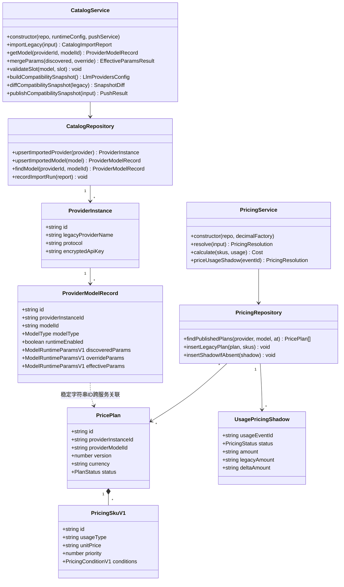
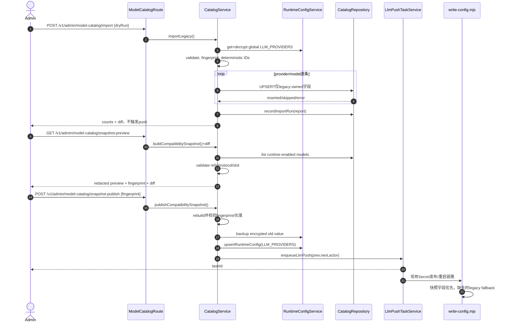
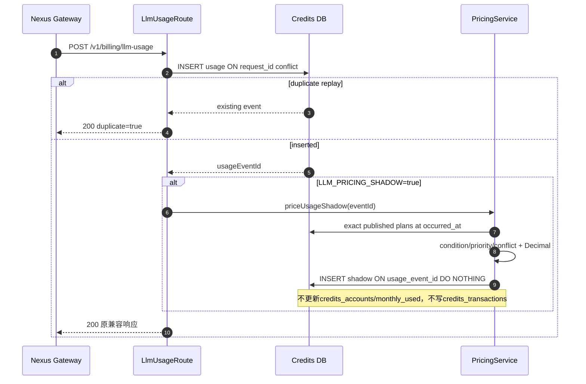
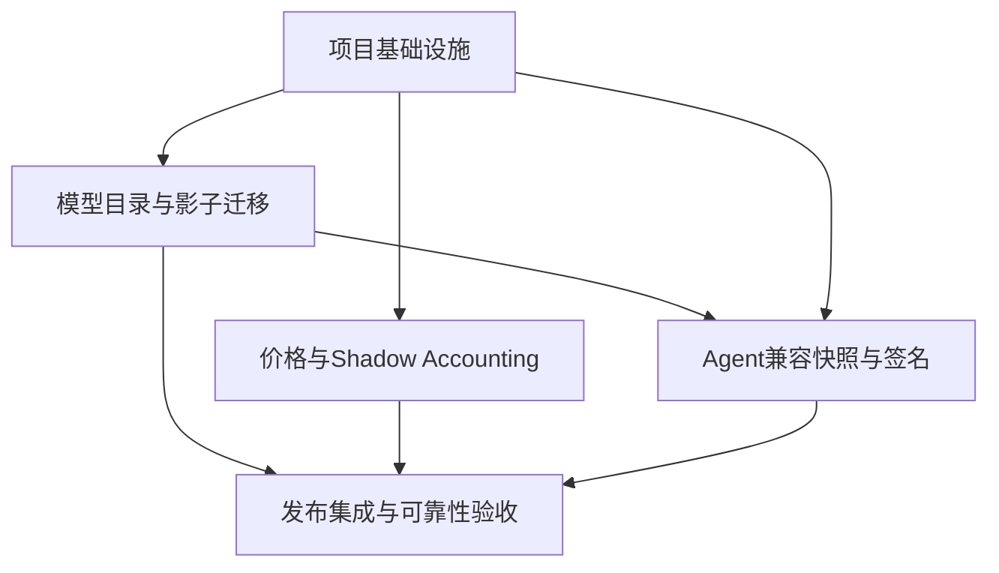

# DealClaw 模型目录平台 P0 增量架构设计

> 状态：实现基线
> 依据：`docs/model-params-sync-plan.md`、`docs/model-catalog-incremental-prd.md`
> 目标：最小变更、可独立关闭、生产安全；本文只定义首轮实现，不切换生产扣费或运行权威。

## Part A：系统设计

## 1. 实现方案

### 1.1 现状契约与不可破坏项

1. provisioning-service 的全局 `runtime_configs(config_key='LLM_PROVIDERS', tenant_id IS NULL)` 是生产运行权威，内容经 AES-256-GCM 加密；租户通过 `LLM_MODEL_SELECTION` 保存引用，不复制供应商密钥。
2. 发布时由 `resolveEffectiveLlmProviders` 生成租户有效配置并写入 `tenant-config` Secret；Gateway 上游写入 `llm-proxy-config.LLM_UPSTREAMS`。
3. 全局保存通过 `llm_push_tasks` / `llm_push_task_items` 异步发布，现有加密前后快照、`FOR UPDATE SKIP LOCKED`、租约、reaper、重试/取消和 SSE 协议保持不变。
4. 当前模型条目是 `{id, reasoning?, vision?}`；`modelSpecSignature()` 使用模型 JSON。新快照必须继续接受旧条目。
5. credits-ledger 的 `llm_token_pricing` 是现行价格展示权威；`llm_usage_events` 只记录 usage，绝不扣减 credits。现有 `request_id` 幂等语义不变。
6. Agent 的 `write-config.mjs` 当前通过模型 ID、`reasoning`、`vision` 猜测参数；P0 仅让其优先消费兼容快照，缺字段仍走原 fallback，且启动时不增加网络调用。

### 1.2 核心技术挑战

- 同时维护“旧 JSON 运行权威”和“新结构化影子数据”，避免隐式双写导致漂移。
- 参数需保存 discovered / override / effective 三层，并完成跨字段、模型类型和运行协议校验。
- 价格存在时段条件、优先级、冲突与 decimal 精度，不能复用 JavaScript 浮点算法作为权威结果。
- 两个服务可能物理隔离，目录与价格只能以稳定字符串 ID 和版本化契约关联，不能跨库外键。
- 新字段必须通过现有差分推送准确识别，同时不能因无关模型变化重启全部租户。
- `runtime-config.ts` 当前单值 8192 字符限制可能阻止扩展快照；P0 不放宽通用密钥限制，发布前按最终序列化长度校验，并把是否提升上限列为容量确认项。

### 1.3 框架、库与模式选择

- 沿用 TypeScript、Node.js、Express、PostgreSQL、Vitest、Supertest，不引入新服务。
- Schema 校验采用 `zod@^3.23.8`：版本化对象、严格未知字段、discriminated union 和跨字段 `superRefine` 比继续扩展手写 validator 更安全；仅位于服务端领域边界。
- 金额计算采用 `decimal.js@^10.4.3`；API/JSON 使用 decimal 字符串，SQL 使用 `NUMERIC(24,12)`，禁止将权威金额转为 `number`。
- 架构模式采用分层领域服务：Route 只做认证/DTO；Catalog/Pricing Service 负责规则；Repository 封装 SQL；Legacy Importer/Compatibility Snapshot 作为防腐层。
- 使用 expand-only migration。P0 不删除旧表/列、不增加会破坏旧写入的非空列。
- 不采用 ORM、不建立独立 catalog service、不实现供应商实时发现；降低首轮改动面。

### 1.4 P0 组件边界

| 组件 | 负责 | 不负责 |
|---|---|---|
| provisioning Catalog Domain | provider instance、model、Schema 校验、三层合并、精确查询、槽位校验、兼容快照与差异 | 自动发现、自动发布、价格、租户扣费 |
| Legacy Catalog Importer | 解密全局旧配置并幂等影子导入、逐条报告 | 修改/删除旧 JSON、触发 push |
| Compatibility Snapshot | 从结构化目录生成旧格式超集、预览差异、显式发布 | 绕过现有 runtime config 和 push task |
| credits Pricing Domain | plan/SKU、精确时点解析、条件匹配、冲突检测、decimal 成本 | 生产扣费、跨 provider 前缀兜底 |
| Legacy Pricing Importer | 旧价格表幂等导入 published plan/SKU | 修改旧表、改变现行展示算法 |
| Shadow Accounting | usage 写入后计算并固化 shadow 结果/差异 | 修改余额、monthly_used、transactions |
| Agent Runtime | 消费已发布快照的已确认字段 | 读结构化表、调用供应商 API、运行非 chat 模型 |

## 2. 文件列表

### 2.1 新增

- `packages/provisioning-service/src/domain/model-catalog.ts`：版本化类型、Zod Schema、合并与跨字段校验。
- `packages/provisioning-service/src/services/model-catalog.ts`：Catalog Service、Repository、槽位校验、兼容快照/差异。
- `packages/provisioning-service/src/services/model-catalog-import.ts`：`LLM_PROVIDERS` 幂等影子导入和报告。
- `packages/provisioning-service/src/routes/model-catalog.ts`：P0 管理 API。
- `packages/provisioning-service/src/__tests__/model-catalog.test.ts`：Schema、合并、快照、槽位单测。
- `packages/provisioning-service/src/__tests__/model-catalog-import.test.ts`：数据库幂等导入测试。
- `packages/credits-ledger/src/domain/llm-pricing.ts`：Pricing v1 Schema、DTO、状态类型。
- `packages/credits-ledger/src/services/llm-pricing.ts`：精确解析、条件匹配、冲突检测、decimal 计算。
- `packages/credits-ledger/src/services/llm-pricing-import.ts`：旧 `llm_token_pricing` 幂等导入。
- `packages/credits-ledger/src/__tests__/llm-pricing.test.ts`：解析与 decimal 单测。
- `packages/credits-ledger/src/__tests__/llm-pricing-import.test.ts`：迁移幂等/不可变测试。
- `packages/dealclaw-agent/src/__tests__/write-config-models.test.ts`：快照优先、legacy fallback、过滤测试。

### 2.2 修改

- `packages/provisioning-service/src/db/migrate.ts`：新增目录、导入运行与快照备份表及约束。
- `packages/provisioning-service/src/config.ts`：三个目录开关。
- `packages/provisioning-service/src/app.ts`：挂载目录路由。
- `packages/provisioning-service/src/routes/runtime-configs.ts`：显式快照发布接入旧保存/push；默认保存路径不变。
- `packages/provisioning-service/src/services/llm-providers.ts`：兼容字段类型、规范化签名、运行协议过滤。
- `packages/provisioning-service/src/services/runtime-config.ts`：仅增加快照发布的长度预检/版本备份调用，不改变通用读取语义。
- `packages/provisioning-service/src/__tests__/llm-providers.test.ts`：新增字段和精确差分回归。
- `packages/provisioning-service/src/__tests__/llm-push-task.test.ts`、`src/__tests__/llm-push.test.ts`：证明新发布仍复用任务状态机/SSE。
- `packages/provisioning-service/package.json`：增加 Zod。
- `packages/credits-ledger/src/db/migrate.ts`：新增价格表、shadow 表与 nullable usage 列。
- `packages/credits-ledger/src/routes/llm-usage.ts`：在旧 usage 幂等写入成功后运行可关闭的 shadow；旧返回和汇总保持兼容。
- `packages/credits-ledger/src/app.ts`：注入/挂载价格只读、导入管理入口（也可在现有 router 内挂载）。
- `packages/credits-ledger/src/__tests__/api.test.ts`：usage 不扣费与 replay 不重复 shadow 集成测试。
- `packages/credits-ledger/package.json`：增加 Zod、Decimal.js。
- `packages/dealclaw-agent/runtime/write-config.mjs`：优先快照参数、协议/类型过滤、缺失 fallback。
- `pnpm-lock.yaml`：锁定新增依赖。

不修改 `llm-push-task.ts` 的状态机和表结构；仅通过现有 `enqueueLlmPush()` 复用它。

## 3. 数据结构与接口

### 3.1 provisioning-service DDL

```sql
CREATE TABLE IF NOT EXISTS llm_provider_instances (
  id TEXT PRIMARY KEY,
  legacy_provider_name TEXT NOT NULL,
  template_key TEXT NOT NULL DEFAULT 'custom-openai',
  display_name TEXT,
  protocol TEXT NOT NULL DEFAULT 'openai-completions',
  base_url TEXT NOT NULL,
  encrypted_api_key TEXT NOT NULL,
  source TEXT NOT NULL,
  enabled BOOLEAN NOT NULL DEFAULT TRUE,
  metadata JSONB NOT NULL DEFAULT '{}'::jsonb,
  created_at TIMESTAMPTZ NOT NULL DEFAULT NOW(),
  updated_at TIMESTAMPTZ NOT NULL DEFAULT NOW(),
  CHECK (source IN ('legacy-import','manual','builtin-catalog')),
  CHECK (protocol IN ('openai-completions')),
  UNIQUE (legacy_provider_name)
);

CREATE TABLE IF NOT EXISTS llm_provider_models (
  id TEXT PRIMARY KEY,
  provider_instance_id TEXT NOT NULL REFERENCES llm_provider_instances(id) ON DELETE CASCADE,
  model_id TEXT NOT NULL,
  display_name TEXT,
  model_type TEXT NOT NULL DEFAULT 'unknown',
  runtime_enabled BOOLEAN NOT NULL DEFAULT FALSE,
  discovered_params JSONB,
  override_params JSONB,
  effective_params JSONB NOT NULL,
  params_schema_version INTEGER NOT NULL DEFAULT 1,
  params_status TEXT NOT NULL,
  source TEXT NOT NULL,
  created_at TIMESTAMPTZ NOT NULL DEFAULT NOW(),
  updated_at TIMESTAMPTZ NOT NULL DEFAULT NOW(),
  CHECK (model_type IN ('chat','embedding','rerank','image-generation','image-edit','speech','transcription','audio-generation','video-generation','multimodal-embedding','unknown')),
  CHECK (params_status IN ('complete','incomplete','fallback','invalid')),
  CHECK (source IN ('legacy-import','manual','builtin-catalog')),
  CHECK (jsonb_typeof(effective_params) = 'object'),
  UNIQUE (provider_instance_id, model_id)
);
CREATE INDEX IF NOT EXISTS idx_llm_provider_models_runtime ON llm_provider_models(provider_instance_id, runtime_enabled);

CREATE TABLE IF NOT EXISTS llm_catalog_import_runs (
  id UUID PRIMARY KEY,
  source_kind TEXT NOT NULL,
  source_fingerprint TEXT NOT NULL,
  status TEXT NOT NULL,
  total_count INTEGER NOT NULL DEFAULT 0,
  succeeded_count INTEGER NOT NULL DEFAULT 0,
  skipped_count INTEGER NOT NULL DEFAULT 0,
  error_count INTEGER NOT NULL DEFAULT 0,
  report JSONB NOT NULL DEFAULT '{}'::jsonb,
  started_at TIMESTAMPTZ NOT NULL DEFAULT NOW(),
  finished_at TIMESTAMPTZ,
  CHECK (source_kind IN ('legacy-runtime-config','manual','builtin-catalog')),
  CHECK (status IN ('running','succeeded','partial','failed')),
  UNIQUE (source_kind, source_fingerprint)
);

CREATE TABLE IF NOT EXISTS llm_catalog_snapshot_backups (
  id UUID PRIMARY KEY,
  runtime_config_id BIGINT REFERENCES runtime_configs(id) ON DELETE SET NULL,
  encrypted_value TEXT NOT NULL,
  source_fingerprint TEXT NOT NULL,
  actor TEXT,
  created_at TIMESTAMPTZ NOT NULL DEFAULT NOW()
);
```

ID 规则：`provider_instance_id = 'lpi_' + sha256('v1\0' + legacyProviderName).slice(0,24)`；`provider_model_id = 'lpm_' + sha256('v1\0' + providerInstanceId + '\0' + modelId).slice(0,24)`。自然键唯一约束是最终幂等保障。API 可公开稳定 ID，不公开密钥。

### 3.2 credits-ledger DDL

```sql
CREATE TABLE IF NOT EXISTS llm_model_price_plans (
  id TEXT PRIMARY KEY,
  provider_instance_id TEXT NOT NULL,
  provider_model_id TEXT NOT NULL,
  provider_key TEXT NOT NULL,
  model_id TEXT NOT NULL,
  version INTEGER NOT NULL,
  status TEXT NOT NULL,
  currency CHAR(3) NOT NULL,
  unit_scale INTEGER NOT NULL DEFAULT 1000000,
  valid_from TIMESTAMPTZ NOT NULL,
  valid_to TIMESTAMPTZ,
  source TEXT NOT NULL,
  source_key TEXT NOT NULL,
  contract_version INTEGER NOT NULL DEFAULT 1,
  published_at TIMESTAMPTZ,
  created_at TIMESTAMPTZ NOT NULL DEFAULT NOW(),
  CHECK (status IN ('draft','published','superseded','disabled')),
  CHECK (currency ~ '^[A-Z]{3}$'),
  CHECK (unit_scale > 0),
  CHECK (valid_to IS NULL OR valid_to > valid_from),
  UNIQUE (provider_instance_id, provider_model_id, version),
  UNIQUE (source, source_key)
);
CREATE INDEX IF NOT EXISTS idx_llm_price_plan_resolve
  ON llm_model_price_plans(provider_key, model_id, valid_from, valid_to) WHERE status = 'published';

CREATE TABLE IF NOT EXISTS llm_model_price_items (
  id TEXT PRIMARY KEY,
  plan_id TEXT NOT NULL REFERENCES llm_model_price_plans(id) ON DELETE RESTRICT,
  usage_type TEXT NOT NULL,
  unit_price NUMERIC(24,12) NOT NULL,
  priority INTEGER NOT NULL DEFAULT 0,
  conditions JSONB NOT NULL DEFAULT '{}'::jsonb,
  created_at TIMESTAMPTZ NOT NULL DEFAULT NOW(),
  CHECK (usage_type IN ('input','input-cache-read','input-cache-write','output','request','image','audio-second','video-second')),
  CHECK (unit_price >= 0),
  CHECK (jsonb_typeof(conditions) = 'object'),
  UNIQUE (plan_id, usage_type, priority, conditions)
);

CREATE TABLE IF NOT EXISTS llm_price_sync_runs (
  id UUID PRIMARY KEY,
  source_kind TEXT NOT NULL,
  source_fingerprint TEXT NOT NULL,
  status TEXT NOT NULL,
  total_count INTEGER NOT NULL DEFAULT 0,
  succeeded_count INTEGER NOT NULL DEFAULT 0,
  skipped_count INTEGER NOT NULL DEFAULT 0,
  error_count INTEGER NOT NULL DEFAULT 0,
  report JSONB NOT NULL DEFAULT '{}'::jsonb,
  started_at TIMESTAMPTZ NOT NULL DEFAULT NOW(),
  finished_at TIMESTAMPTZ,
  CHECK (status IN ('running','succeeded','partial','failed')),
  UNIQUE (source_kind, source_fingerprint)
);

ALTER TABLE llm_usage_events ADD COLUMN IF NOT EXISTS pricing_status TEXT;
ALTER TABLE llm_usage_events ADD COLUMN IF NOT EXISTS price_plan_id TEXT;
ALTER TABLE llm_usage_events ADD COLUMN IF NOT EXISTS pricing_snapshot JSONB;
ALTER TABLE llm_usage_events ADD COLUMN IF NOT EXISTS upstream_cost_amount NUMERIC(24,12);
ALTER TABLE llm_usage_events ADD COLUMN IF NOT EXISTS upstream_cost_currency CHAR(3);

CREATE TABLE IF NOT EXISTS llm_usage_pricing_shadows (
  usage_event_id VARCHAR(64) PRIMARY KEY REFERENCES llm_usage_events(id) ON DELETE CASCADE,
  resolver_version INTEGER NOT NULL,
  status TEXT NOT NULL,
  price_plan_id TEXT,
  matched_item_ids TEXT[] NOT NULL DEFAULT '{}',
  amount NUMERIC(24,12),
  currency CHAR(3),
  legacy_amount NUMERIC(24,12),
  delta_amount NUMERIC(24,12),
  pricing_snapshot JSONB NOT NULL,
  error_code TEXT,
  created_at TIMESTAMPTZ NOT NULL DEFAULT NOW(),
  CHECK (status IN ('resolved','unknown','conflict','pending','free')),
  CHECK ((status IN ('resolved','free') AND amount IS NOT NULL) OR status NOT IN ('resolved','free'))
);
```

数据库物理隔离时不对目录 ID建外键。`provider_key + model_id` 是 P0 usage 解析键，稳定 ID用于审计；`contract_version=1` 必须写入快照。published plan 由服务层禁止 `UPDATE`，数据库权限可在生产进一步收紧；更正必须创建新 version。

### 3.3 TypeScript 契约

```ts
type ModelType = 'chat'|'embedding'|'rerank'|'image-generation'|'image-edit'|'speech'|'transcription'|'audio-generation'|'video-generation'|'multimodal-embedding'|'unknown';
type ModelModality = 'text'|'image'|'audio'|'video';
type ParamsStatus = 'complete'|'incomplete'|'fallback'|'invalid';

interface ModelRuntimeParamsV1 {
  contextWindow?: number;
  maxInputTokens?: number;
  maxOutputTokens?: number;
  maxReasoningTokens?: number;
  inputModalities?: ModelModality[];
  outputModalities?: ModelModality[];
  reasoning?: boolean;
  vision?: boolean;
  toolCalling?: boolean;
  structuredOutput?: boolean;
  compat?: Record<string, boolean|string|number>;
  embedding?: { dimensions?: number; maxBatchSize?: number };
  rerank?: { maxDocuments?: number; maxDocumentTokens?: number };
  image?: { sizes?: string[]; qualities?: string[] };
  audio?: { formats?: string[]; voices?: string[]; maxSeconds?: number };
  video?: { maxSeconds?: number; resolutions?: string[]; fps?: number[] };
}

interface ProviderModelRecord {
  id: string; providerInstanceId: string; modelId: string; displayName?: string;
  modelType: ModelType; runtimeEnabled: boolean;
  discoveredParams?: ModelRuntimeParamsV1; overrideParams?: ModelRuntimeParamsV1;
  effectiveParams: ModelRuntimeParamsV1; paramsStatus: ParamsStatus; schemaVersion: 1;
}

interface CompatibilityModelSpec {
  id: string; displayName?: string; modelType?: ModelType;
  protocol?: 'openai-completions'; contextWindow?: number; maxOutputTokens?: number;
  inputModalities?: ModelModality[]; reasoning?: boolean; vision?: boolean;
  compat?: Record<string, boolean|string|number>;
}

interface PricingConditionV1 {
  timezone?: string; weekdays?: number[]; startTime?: string; endTime?: string;
  cacheState?: 'hit'|'miss'; requestTags?: Record<string,string>;
}
type PricingStatus = 'resolved'|'unknown'|'conflict'|'pending'|'free';
interface PricingSkuV1 { id: string; usageType: string; unitPrice: string; priority: number; conditions: PricingConditionV1 }
interface PricingResolution { status: PricingStatus; amount?: string; currency?: string; planId?: string; matchedSkuIds: string[]; reason?: string }

interface CatalogService {
  importLegacy(input: { dryRun: boolean; actor: string }): Promise<CatalogImportReport>;
  getModel(providerInstanceId: string, modelId: string): Promise<ProviderModelRecord|null>;
  mergeParams(discovered?: ModelRuntimeParamsV1, override?: ModelRuntimeParamsV1): EffectiveParamsResult;
  validateSlot(model: ProviderModelRecord, slot: 'default'|'image'|'compaction'|'fallback'): void;
  buildCompatibilitySnapshot(): Promise<LlmProvidersConfig>;
  diffCompatibilitySnapshot(legacy: LlmProvidersConfig): Promise<SnapshotDiff>;
  publishCompatibilitySnapshot(input: { expectedFingerprint: string; actor: string }): Promise<{taskId: string}>;
}
interface PricingService {
  importLegacy(input: { dryRun: boolean }): Promise<PricingImportReport>;
  resolve(input: { provider: string; model: string; occurredAt: Date; usage: TokenUsage }): Promise<PricingResolution>;
  calculate(skus: PricingSkuV1[], usage: TokenUsage): { amount: string; currency: string };
  priceUsageShadow(usageEventId: string): Promise<PricingResolution>;
}
```

合并按字段递归执行 `override ?? discovered ?? safeFallback`。safe fallback 仅用于运行兼容字段并标为 `fallback`，不得写回 `discovered_params`。校验规则：Token 是正整数；`maxInputTokens`/`maxOutputTokens` 不得大于 context；`vision=true` 必须含 image 输入；非 chat、非 `openai-completions`、invalid 模型不得进入 chat 槽位。

### 3.4 类关系图



## 4. 程序调用流程





### 4.1 P0 管理 API

- `POST /v1/admin/model-catalog/import`：`{dryRun:boolean}`；返回逐条脱敏报告。开关关闭返回 404/disabled，不触发 push。
- `GET /v1/admin/model-catalog/providers`、`GET /v1/admin/model-catalog/providers/:id/models`：只读、密钥只返回 `hasApiKey`。
- `GET /v1/admin/model-catalog/snapshot-preview`：返回 redacted snapshot、fingerprint、引用/字段 diff。
- `POST /v1/admin/model-catalog/snapshot-publish`：显式动作，必须传 preview fingerprint；备份旧密文后调用旧保存和 `enqueueLlmPush`。
- `POST /v1/admin/llm-pricing/import`、`GET /v1/admin/llm-pricing/plans`：影子导入/只读；不提供启用生产扣费 API。

统一错误：`{code,message,details?}`；400 Schema、409 fingerprint/price conflict、422 slot/compat invalid、503 disabled。所有管理 API 复用现有 service/admin auth 与 audit。

## 5. 迁移、兼容、开关和回滚

### 5.1 `LLM_PROVIDERS` 幂等影子迁移

1. 只读取全局有效记录，解密并使用现有 validator 校验；原密文不修改。
2. 对规范化 JSON（对象 key 排序，数组保留业务顺序，密钥参与服务内 HMAC 而不出报告）计算 source fingerprint。
3. provider/model 使用确定性 ID和自然键 UPSERT。重跑只更新由 `legacy-import` 所有且尚无人为修改的字段；`source!='legacy-import'` 或已有 override 时跳过并报告。
4. 无法识别模板归 `custom-openai`；旧 `reasoning/vision` 写入 `override_params`。缺失 context/output 保持未知，modelType 默认 `chat` 仅因它来自当前 chat 运行配置，并记录 `legacy-assumption`；不得冒充 discovered。
5. default/image/compaction/fallback 引用在报告中逐一解析；任何悬空引用阻止发布但不阻止其他行导入。
6. 导入本身永不调用 `upsertRuntimeConfig`、Secret 或 push。

### 5.2 `llm_token_pricing` 幂等影子迁移

- `source_key = 'legacy:' + provider + ':' + model`，plan ID由 source key 确定生成；`UNIQUE(source,source_key)` 保证重复运行不新建版本。
- 每行创建 version=1 published plan；将 cache hit、cache miss、output 的 peak/off-peak 数值转成 decimal 字符串 SKU，条件明确 `Asia/Shanghai`、工作日、时间窗口及 cacheState。
- 旧 NUMERIC 通过 pg 字符串读取，禁止先转 `Number`。计划已有但非 legacy-owned 时跳过，绝不覆盖人工数据。
- 峰谷边界必须复刻现有语义；周末落 off-peak。时区/精确边界未确认前只能 shadow。

### 5.3 feature flags

| 环境变量 | 默认 | 作用 | 关闭效果 |
|---|---:|---|---|
| `MODEL_CATALOG_SHADOW_IMPORT` | false | 开放影子导入 API | 不写新目录表 |
| `MODEL_CATALOG_READ` | false | 开放结构化只读与 preview | UI/调用回旧 JSON |
| `MODEL_CATALOG_SNAPSHOT_WRITE` | false | 允许显式生成并发布兼容快照 | 旧供应商保存路径完全不变 |
| `LLM_PRICING_SHADOW` | false | usage 成功写入后做 shadow 解析 | 不写 shadow，旧价格展示不变 |

开关在请求时读取已加载配置；生产变更需滚动服务，但互相独立。数据库迁移始终可先部署。

### 5.4 Agent 兼容路径和签名

兼容模型条目保持 `id/reasoning/vision`，可选增加 `displayName/modelType/protocol/contextWindow/maxOutputTokens/inputModalities/compat`。`write-config.mjs`：

1. 仅 `modelType` 缺失或为 `chat`，且 protocol 缺失或为已确认 `openai-completions` 时下发。
2. 快照存在合法正整数 `contextWindow/maxOutputTokens` 时精确采用；否则调用原 `defaultModelSpec`。
3. `inputModalities` 映射到 OpenClaw 已确认字段；缺失时根据 legacy `vision` 回退。
4. `maxReasoningTokens`、专属子对象和未知 compat 不下发。
5. `modelSpecSignature` 使用固定顺序规范对象：`{protocol,id,contextWindow,maxOutputTokens,inputModalities(sorted),reasoning,vision,compat(sorted)}`，而非任意对象 JSON。只有租户引用模型/供应商的签名变化才重启。

### 5.5 shadow 双算但不扣费

- usage 原始 INSERT 是主操作；shadow 失败不得回滚 usage 或改变 HTTP 成功语义，记录结构化错误和指标。
- 先用现有算法得到 `legacy_amount`（仅对旧表覆盖场景），新解析器只做精确 provider/model/occurredAt 匹配；0 个计划为 unknown，多个同等级有效候选或 SKU 为 conflict。
- `free` 只能来自显式 published 零价方案，不可由未匹配/异常推断。
- 以 `usage_event_id` 唯一插入不可变快照；重放不重算。后续纠错必须新增 revision 机制，P0 不原地覆盖。
- 代码与测试明确禁止调用 account/debit/billing-hook；数据库集成测试比较前后 balance、monthly_used 和 transaction count。

### 5.6 回滚

1. 先关闭对应开关；无需回滚 Schema。
2. 目录读/导入关闭后旧 JSON仍是权威；价格 shadow 关闭后旧价格查询/展示不变。
3. 若已发布兼容快照，从 `llm_catalog_snapshot_backups` 取最近旧密文，以新的显式 restore 操作写回 `runtime_configs`，并复用现有 push task；保留审计。
4. shadow 数据、新表和 nullable usage 列保留，不删除原 usage，不反向调整账户。
5. 仅在后续清理窗口删除影子数据；P0 不提供 destructive rollback migration。

## 6. Required Packages

- `zod@^3.23.8`：provisioning 与 credits 的版本化严格 Schema、跨字段校验。
- `decimal.js@^10.4.3`：credits-ledger 权威 decimal 字符串运算。
- 既有 `pg`、`express`、`vitest`、`supertest` 继续使用，不新增 ORM/队列。

## Part B：任务拆解

## 7. 任务列表（按依赖顺序，不超过 5 项）

### T01 项目基础设施
- **Source Files**：`packages/provisioning-service/package.json`、`packages/credits-ledger/package.json`、`pnpm-lock.yaml`、`packages/provisioning-service/src/config.ts`、`packages/credits-ledger/src/app.ts`、`packages/provisioning-service/src/app.ts`
- **内容**：加入依赖、四个默认关闭开关、路由装配入口；不开启任何生产行为。
- **Dependencies**：无
- **Priority**：P0

### T02 结构化模型目录与影子迁移
- **Source Files**：`packages/provisioning-service/src/db/migrate.ts`、`src/domain/model-catalog.ts`、`src/services/model-catalog.ts`、`src/services/model-catalog-import.ts`、`src/routes/model-catalog.ts`、`src/__tests__/model-catalog.test.ts`、`src/__tests__/model-catalog-import.test.ts`
- **内容**：DDL、Schema、合并/槽位规则、稳定 ID、幂等旧 JSON 导入、只读/preview API；不得触发 push。
- **Dependencies**：T01
- **Priority**：P0

### T03 通用价格与 shadow accounting
- **Source Files**：`packages/credits-ledger/src/db/migrate.ts`、`src/domain/llm-pricing.ts`、`src/services/llm-pricing.ts`、`src/services/llm-pricing-import.ts`、`src/routes/llm-usage.ts`、`src/__tests__/llm-pricing.test.ts`、`src/__tests__/llm-pricing-import.test.ts`、`src/__tests__/api.test.ts`
- **内容**：价格 DDL、旧表幂等导入、Decimal 解析、冲突/unknown/free、usage 后置 shadow 固化和不扣费断言。
- **Dependencies**：T01
- **Priority**：P0

### T04 Agent 兼容快照消费与差分签名
- **Source Files**：`packages/provisioning-service/src/services/llm-providers.ts`、`src/routes/runtime-configs.ts`、`src/services/runtime-config.ts`、`src/__tests__/llm-providers.test.ts`、`packages/dealclaw-agent/runtime/write-config.mjs`、`packages/dealclaw-agent/src/__tests__/write-config-models.test.ts`
- **内容**：扩展旧格式超集、字段白名单、模型过滤、legacy fallback、规范化 signature、备份/长度校验。
- **Dependencies**：T01、T02
- **Priority**：P0

### T05 显式发布集成、可靠性与回滚验收
- **Source Files**：`packages/provisioning-service/src/routes/model-catalog.ts`、`src/routes/runtime-configs.ts`、`src/__tests__/llm-push-task.test.ts`、`src/__tests__/llm-push.test.ts`、`packages/credits-ledger/src/__tests__/api.test.ts`、`packages/dealclaw-agent/src/__tests__/write-config-models.test.ts`
- **内容**：preview fingerprint 并发保护、旧密文备份、复用 enqueue/SSE、完整开关关闭/恢复、跨服务契约和全量回归。
- **Dependencies**：T02、T03、T04
- **Priority**：P0

## 8. Shared Knowledge

- P0 双权威原则：运行仍以旧 `LLM_PROVIDERS` 为权威；现行价格展示仍以 `llm_token_pricing` 为权威。
- 所有金额 API/快照使用 decimal 字符串，数据库使用 NUMERIC；`number` 只允许非账务计数。
- 日期存 ISO 8601 UTC；条件时区显式保存 IANA 名称。
- provider/model 跨服务关联使用稳定字符串 ID + `contractVersion=1`，不建跨库 FK。
- 客户端不得提交 `effective_params`；服务端重算并校验。
- credentials 永不进入 read API、diff、日志、导入报告或 pricing snapshot。
- 结构化目录写入不自动 push；只有明确发布 API复用现有异步 push/SSE。
- unknown/conflict/error 绝不解释为免费；LLM usage 永不扣 credits。
- published price plan 不可原地更新；历史 shadow 快照不可因目录/价格更新重算。

## 9. 任务依赖图



## 10. 测试矩阵

| 层级 | 场景 | 关键断言 |
|---|---|---|
| Schema 单测 | 正/负 Token、input/output > context、vision 无 image、未知字段 | 明确错误路径；effective 不可由客户端传入 |
| 合并单测 | override/discovered/fallback 各组合、嵌套对象 | 字段级优先级正确，fallback 可观测且不污染 discovered |
| Catalog DB 集成 | 相同旧 JSON 连跑两次、坏 provider、人工 override | 第二次新增 0；单条失败隔离；人工值不覆盖 |
| Snapshot 契约 | provider/model/default/image/compaction/fallback round trip | 引用 100% 等价；密钥不出 preview |
| Signature 单测 | 只改 context/output/compat；改无关模型 | 引用租户签名变化；无关租户不重启 |
| Agent 单测 | qwen 1,000,000/131,072；旧条目；embedding；未知字段 | 精确值、legacy 行为不变、非 chat 过滤、未知字段不写 |
| Pricing 单测 | 精确匹配、无方案、显式零价、同优先级冲突 | resolved/unknown/free/conflict 严格区分 |
| Decimal 单测 | 大 Token、高精度、多 SKU | 与数据库 NUMERIC 字符串一致，无浮点误差 |
| 时段单测 | 工作日峰值前后边界、非峰、周末、DST 无关时区 | 与冻结的 Asia/Shanghai 旧语义一致 |
| Price import 集成 | 连跑两次、人工 plan、部分坏行 | 不重复、不覆盖、逐条报告 |
| Usage 集成 | 成功、shadow 异常、request_id replay | usage 均保留；shadow 单条；旧响应兼容 |
| 不扣费集成 | shadow 开启前后 | balance/monthly_used/transactions 完全不变 |
| Push 回归 | publish、retry/cancel、lease/reaper、SSE | 复用现有状态机；任务快照仍加密 |
| Feature flag | 四开关逐一/全部关闭 | 旧路径无需数据库回滚即可工作 |
| 安全 | read/diff/report/log | 无 apiKey、密文、敏感 metadata 泄漏 |
| 性能 | 目录查询；100 SKU 解析 | P95 分别 ≤200ms、≤20ms |

## 11. Anything UNCLEAR / 待确认事项

1. provisioning-service 与 credits-ledger 是否物理独库；本文按独库设计，禁止跨库 FK。
2. 当前部署 OpenClaw 的精确版本、`api` 枚举、model spec 与 `compat` Zod 白名单；M0 必须用实际镜像/包测试冻结，未确认字段不下发。
3. 顶层 `LLM_PROVIDERS.schemaVersion` 对旧 Agent 是否安全；未确认前只在新字段内部保持可选，不增加必需顶层字段。
4. 旧峰谷定价的精确时区、工作日定义和端点包含规则；本文暂按 Asia/Shanghai、周一至周五、现有代码边界建立 fixture。
5. `LLM_PROVIDERS` 8192 字符限制的实际最大存量和增长预测；超限时应先设计专用存储/分页，而不是静默截断。
6. 显式免费价格的审批人和证据字段；未确认前只允许 legacy 明确零价导入形成 free。
7. 发布权限、双人审批、备份保留期；P0 至少复用 admin auth/audit、fingerprint 乐观锁和发布前备份。
8. 稳定 ID 是否需要由共享包统一生成；P0 可在两服务各自以契约 fixture 验证同一算法，后续再提取公共包。
9. 是否在 P0 暴露价格管理路由。若 UI 不需要，可仅保留内部导入命令/测试入口，但表和领域服务不变。
