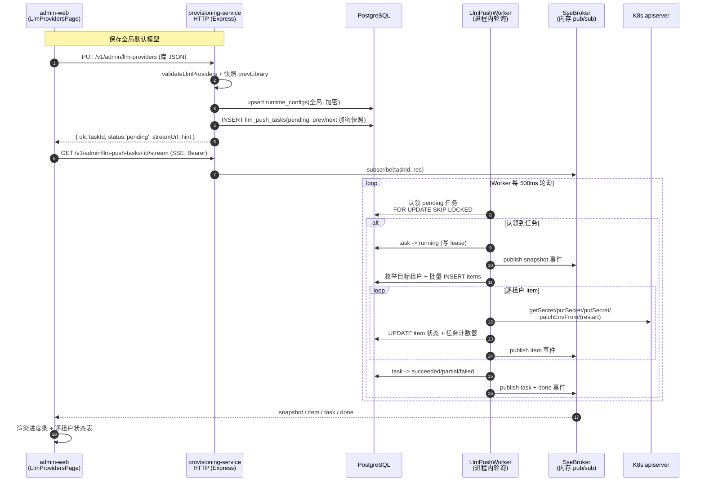
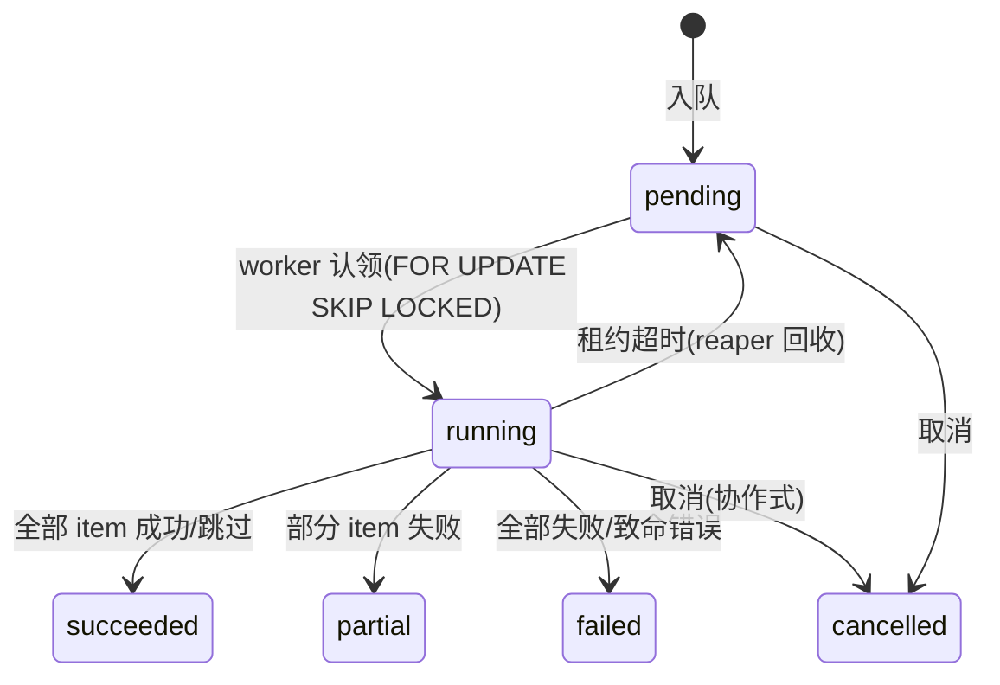

# DealClaw 模型供应商推送异步化 + 进度可视化 — 系统设计与任务分解

> 作者：架构师（高见远）
> 范围：provisioning-service（后端）+ admin-web（前端）
> 目标：把「保存全局默认模型时同步遍历全部活跃租户物化 Secret + 滚动重启」改造成异步任务，并可视化逐租户进度。

---

## 1. 实现方案总览

### 1.1 核心思路

现状问题：`PUT /v1/admin/llm-providers` 在一次 HTTP 请求内 `await pushLlmProviders(pool, config, null, prevLibrary)`，`for` 循环逐租户物化 + 重启。租户多时请求阻塞、无反馈、超时风险。

改造后拆成三块：

1. **入队（enqueue）**：保存接口把「库已写库」之后，不再同步遍历，而是**快照 prev/next 库**、插入一条 `llm_push_tasks` 任务行（`pending`），立即返回 `taskId` + SSE 订阅地址。
2. **Worker（后台执行）**：进程内轮询循环用 PostgreSQL `FOR UPDATE SKIP LOCKED` 认领 `pending` 任务，逐租户执行物化/重启，边做边写逐租户进度（`llm_push_task_items`）并推送 SSE 事件。
3. **进度订阅（SSE）**：前端拿到 `taskId` 后打开 `GET /v1/admin/llm-push-tasks/:id/stream`，通过 `fetch + ReadableStream`（复用 `PodLogsModal` 已有模式）实时收到 snapshot / item / task / done 事件，渲染进度条 + 逐租户状态表。

### 1.2 全链路时序图



---

## 2. 异步执行机制选型

| 方案 | 描述 | 优点 | 缺点 |
|------|------|------|------|
| ① BullMQ + Redis | 引入队列中间件 | 成熟、重试/延迟/优先级内置、天然多副本 | **新依赖 Redis + BullMQ + ioredis**，新运维面（Redis 集群/持久化/监控），与现状（无任何队列）差距大，过度设计 |
| ② **PG 任务表 + `FOR UPDATE SKIP LOCKED`（推荐）** | 任务/进度持久化在 PG，进程内轮询认领 | 零新依赖、契合现状（已有 `pg`）、抗崩溃、未来多副本可扩展、进度查询与历史列表天然有 SQL 支撑 | 需自己实现认领/租约/重试（工作量可控） |
| ③ 纯内存队列 | `Array`/`EventEmitter` 队列 | 最轻 | **不抗崩溃/重启**，任务丢失，无法做历史列表 |

**推荐：方案 ②**。理由：

- 当前**单实例、无 Redis**，引入 BullMQ 要新增 Redis 依赖与运维面，收益不足以覆盖成本。
- PostgreSQL 已是唯一共享真源（`runtime_configs` 全局库、`tenants` 都在这里），把任务状态落到 PG 是最自然的持久化点，**进程重启/崩溃后可从表里恢复**。
- `FOR UPDATE SKIP LOCKED` 是 PG 原生并发认领原语，未来扩容多副本时多个 worker 各自认领不同任务，**不会重复执行**，无需额外协调服务。

### 2.1 崩溃恢复 / 孤儿任务处理

- **租约（lease）**：认领任务时写 `lease_owner`（进程标识）与 `lease_expires_at = now() + TTL`。每处理完一个租户 item 续租一次（`lease_expires_at = now() + TTL`），TTL 默认 10 分钟，覆盖单租户最坏 ~40s 重启（`restartDeployment` scale-to-0 + ≤30s 轮询）。
- **孤儿回收（reaper）**：周期性 `UPDATE llm_push_tasks SET status='pending', lease_owner=NULL WHERE status='running' AND lease_expires_at < now()`。回收后任务回到 `pending`，下一轮被（可能另一个进程）重新认领。
- **断点续跑**：item 状态已持久化到 `llm_push_task_items`，重新认领时**只处理仍为 `pending` 的 item**，已 `succeeded/skipped/failed` 的跳过。`applyTenantLlmConfig` 幂等（`putSecret` 为 upsert、重启为注解 patch、`patchDeploymentEnvFromSecret` 幂等），即使上次在「已写 Secret、未写状态」之间崩溃，重跑也是安全的。
- **任务级致命错误**（如枚举租户失败）→ 任务置 `failed` + `error`，不进入死循环。

---

## 3. 数据模型

采用**两张表**：父任务表 + 逐租户 item 表（而非单表 JSONB）。理由：item 可被单独重试/更新（行级锁不争用父表）、失败租户可按 `task_id + status` 索引快速查询、历史列表可直接 `JOIN`，语义比 JSONB 更清晰，符合本仓库既有风格（`tenant_status_log`、`chat_messages` 等均为独立表）。

### 3.1 状态机

**任务状态（llm_push_tasks.status）**



**item 状态（llm_push_task_items.status）**

```
pending → running → succeeded | skipped | failed
```

- `succeeded`：该租户 Secret 已物化（`restarted`/`gateway_restarted` 标记是否滚了 agent/gateway；`skip_restart=true` 表示差分判定无需重启但 Secret 已同步）。
- `skipped`：无需物化（无 namespace / k8sDryRun），无副作用。
- `failed`：抛异常，`error` 记录消息。

### 3.2 DDL（追加到 `packages/provisioning-service/src/db/migrate.ts`）

```sql
-- ── LLM push async task (v0.11) ──────────────────────────────────────────
-- 把「全局库写入 → 逐租户物化 + 滚动重启」从同步 HTTP 请求改为持久化任务。
-- prev_library / next_library 用与 runtime_configs 相同的 AES-256-GCM 加密
-- （services/crypto.ts encryptValue），worker 执行时再解密，避免密钥明文二处落库。
CREATE TABLE IF NOT EXISTS llm_push_tasks (
  id                TEXT PRIMARY KEY,               -- 应用层 randomUUID()
  kind              TEXT NOT NULL CHECK (kind IN ('global_push','tenant_push')),
  scope             TEXT,                            -- NULL=全局；tenant_push 时为 tenant_id
  trigger           TEXT NOT NULL DEFAULT 'save' CHECK (trigger IN ('save','delete','selection','retry')),
  status            TEXT NOT NULL DEFAULT 'pending'
                    CHECK (status IN ('pending','running','succeeded','partial','failed','cancelled')),
  prev_library      TEXT,                            -- 加密 JSON（LlmProvidersConfig | null）
  next_library      TEXT,                            -- 加密 JSON（LlmProvidersConfig | null）
  total_count       INTEGER NOT NULL DEFAULT 0,
  succeeded_count   INTEGER NOT NULL DEFAULT 0,
  failed_count      INTEGER NOT NULL DEFAULT 0,
  skipped_count     INTEGER NOT NULL DEFAULT 0,
  error             TEXT,                            -- 任务级致命错误
  actor             TEXT,
  actor_type        TEXT NOT NULL DEFAULT 'admin' CHECK (actor_type IN ('admin','service')),
  lease_owner       TEXT,                            -- worker 进程标识
  lease_expires_at  TIMESTAMPTZ,                     -- 续租 TTL
  cancel_requested  BOOLEAN NOT NULL DEFAULT FALSE,  -- 协作式取消标记
  created_at        TIMESTAMPTZ NOT NULL DEFAULT NOW(),
  started_at        TIMESTAMPTZ,
  finished_at       TIMESTAMPTZ
);
CREATE INDEX IF NOT EXISTS idx_llm_push_tasks_status ON llm_push_tasks(status, created_at);
CREATE INDEX IF NOT EXISTS idx_llm_push_tasks_created ON llm_push_tasks(created_at DESC);

CREATE TABLE IF NOT EXISTS llm_push_task_items (
  id                BIGSERIAL PRIMARY KEY,
  task_id           TEXT NOT NULL REFERENCES llm_push_tasks(id) ON DELETE CASCADE,
  tenant_id         TEXT NOT NULL,
  status            TEXT NOT NULL DEFAULT 'pending'
                    CHECK (status IN ('pending','running','succeeded','skipped','failed')),
  restarted         BOOLEAN NOT NULL DEFAULT FALSE,  -- agent 是否滚动
  gateway_restarted BOOLEAN NOT NULL DEFAULT FALSE,  -- gateway 是否滚动
  skip_restart      BOOLEAN NOT NULL DEFAULT FALSE,  -- 差分判定无需重启但 Secret 已物化
  error             TEXT,
  attempts          INTEGER NOT NULL DEFAULT 0,
  started_at        TIMESTAMPTZ,
  finished_at       TIMESTAMPTZ,
  updated_at        TIMESTAMPTZ NOT NULL DEFAULT NOW()
);
CREATE INDEX IF NOT EXISTS idx_llm_push_items_task ON llm_push_task_items(task_id, id);
CREATE INDEX IF NOT EXISTS idx_llm_push_items_status ON llm_push_task_items(task_id, status);
```

### 3.3 如何支持三类诉求

- **重启/崩溃后恢复**：见 2.1。任务行 + item 行都在 PG，reaper 回收超时 `running` 任务，worker 断点续跑 `pending` item。
- **进度查询**：`total_count / succeeded_count / failed_count / skipped_count` 计数器在父表上随 item 完成原子递增，O(1) 读进度；明细查 `llm_push_task_items`。
- **历史任务列表**：`SELECT * FROM llm_push_tasks ORDER BY created_at DESC LIMIT $n`，配合 `idx_llm_push_tasks_created`。

---

## 4. 进度推送通道选型

| 维度 | SSE（chunked HTTP，推荐） | WebSocket |
|------|---------------------------|-----------|
| 前端实现 | `fetch + res.body.getReader()`，**已有 `PodLogsModal` 范本** | 需新写 WS 客户端 + 断线重连 |
| 鉴权 | 同源请求直接带 `Authorization: Bearer` 头 | 浏览器 WS 不能带自定义头，需首条 `{"type":"auth"}` 消息（已有 pod-exec 方案） |
| 服务端接入 | 纯 Express 路由 `res.write`，**零改动 `server.on('upgrade')`** | 现有 `pod-exec.ts` 的 upgrade handler 会对非 exec 路径 `socket.destroy()`，需改造协调 |
| 方向 | 单向 server→client（进度只需这个） | 双向（本场景用不到） |
| 断线恢复 | 重开流 + 先 `GET` 任务详情对齐 | 需自己维护重连/补发 |
| 依赖 | 零新增 | `ws` 已存在（但多余） |

**推荐 SSE**。关键原因：复用已验证的 `PodLogsModal` chunked 流模式，同源带鉴权，且**不动** `ws/pod-exec.ts` 的 upgrade 处理。

### 4.1 SSE 事件协议（JSON 行）

采用标准 SSE 帧（`event:` + `data:` + 空行），`data` 为单行 JSON；`id` 自增用于断线续传（v1 前端主要靠「重开流 + 先拉详情」对齐，`id` 保留但不强依赖）。

```text
retry: 3000

event: snapshot
id: 1
data: {"taskId":"8f1c…","status":"running","totalCount":120,"succeededCount":0,"failedCount":0,"skippedCount":0,"items":[]}

event: item
id: 2
data: {"taskId":"8f1c…","tenantId":"a1b2…","status":"succeeded","restarted":true,"gatewayRestarted":false,"skipRestart":false,"error":null}

event: task
id: 3
data: {"taskId":"8f1c…","status":"partial","totalCount":120,"succeededCount":118,"failedCount":1,"skippedCount":1,"error":null,"hint":"已写入 118/120 个租户…；1 个租户推送失败"}

event: done
id: 4
data: {"taskId":"8f1c…"}

: ping
```

- `snapshot`：订阅建立后**首帧**必发，携带任务元数据 + 当前已完成 item（让晚订阅者对齐状态）。
- `item`：每完成一个租户发一帧。
- `task`：终态帧，携带最终 `hint`（复用现有 `pushLlmProviders` 的 `hint` 措辞）。
- `done`：永远最后一帧，前端收到后关闭流。
- 心跳：`res.write(': ping\n\n')` 每 15s，防代理/ALB 空闲超时。

---

## 5. 后端接口设计

### 5.1 新端点（全部沿用 `createServiceOrAdminAuthMiddleware`）

| 方法 | 路径 | 说明 |
|------|------|------|
| GET | `/v1/admin/llm-push-tasks` | 任务历史列表 |
| GET | `/v1/admin/llm-push-tasks/:taskId` | 任务详情 + items 全量快照 |
| GET | `/v1/admin/llm-push-tasks/:taskId/stream` | SSE 进度订阅 |
| POST | `/v1/admin/llm-push-tasks/:taskId/retry` | 重试失败租户 |
| POST | `/v1/admin/llm-push-tasks/:taskId/cancel` | 协作式取消（v1 可选） |

#### 5.1.1 GET `/v1/admin/llm-push-tasks`（列表）

Query：`limit=50&offset=0&status=running|pending|succeeded|partial|failed|cancelled`

```json
{ "tasks": [ { "id":"…", "kind":"global_push", "trigger":"save", "status":"partial",
  "totalCount":120, "succeededCount":118, "failedCount":1, "skippedCount":1,
  "createdAt":"…", "finishedAt":"…" } ], "total": 37 }
```

#### 5.1.2 GET `/v1/admin/llm-push-tasks/:taskId`（详情）

```json
{
  "task": { "id":"…", "kind":"global_push", "scope":null, "trigger":"save",
    "status":"partial", "totalCount":120, "succeededCount":118, "failedCount":1,
    "skippedCount":1, "error":null, "createdAt":"…", "startedAt":"…", "finishedAt":"…" },
  "items": [
    { "tenantId":"…", "status":"succeeded", "restarted":true, "gatewayRestarted":true, "skipRestart":false, "error":null },
    { "tenantId":"…", "status":"failed", "restarted":false, "gatewayRestarted":false, "skipRestart":false, "error":"putSecret tenant-config failed: 403" }
  ]
}
```

#### 5.1.3 POST `/v1/admin/llm-push-tasks/:taskId/retry`（重试失败租户）

Body 可选 `{ "tenantIds": ["a1b2…"] }`（缺省 = 该任务全部 `failed` item）。

```json
{ "ok": true, "resetCount": 2 }
```

行为：把指定 `failed` item 置回 `pending`（`attempts+1`、清 `error`），任务若已终态则置回 `pending`，等待 worker 再认领。幂等：只重置 `failed` 的 item。

#### 5.1.4 POST `/v1/admin/llm-push-tasks/:taskId/cancel`（可选 v1）

```json
{ "ok": true, "status": "cancelled" }
```

行为：`pending` 直接置 `cancelled`；`running` 置 `cancel_requested=true`，worker 在租户间边界检查并停止（已 in-flight 的单租户重启不打断）。

### 5.2 改造现有 `PUT /v1/admin/llm-providers`

从「同步返回 push 结果」变为「返回 taskId + 立即可订阅」：

**旧响应**
```json
{ "ok": true, "push": { "hint":"已写入 37/37 …" } }
```

**新响应**
```json
{
  "ok": true,
  "taskId": "8f1c…",
  "status": "pending",
  "streamUrl": "/v1/admin/llm-push-tasks/8f1c…/stream",
  "hint": "配置已保存，正在后台推送到所有租户（约 1–2 分钟生效），可查看进度"
}
```

handler 变更点（`routes/runtime-configs.ts`）：
1. `validateLlmProviders` → 快照 `prevLibrary`（不变）。
2. `upsertRuntimeConfig` 写全局库（不变）。
3. **删掉 `await pushLlmProviders(pool, config, null, prevLibrary)`**，改为 `enqueueLlmPush(pool, config, { kind:'global_push', scope:null, trigger:'save', prevLibrary, nextLibrary: doc, actor })`。
4. 审计 `newValue` 里带 `taskId`（`push` 字段不再有逐租户结果，改为 `{ taskId, async: true }`）。
5. 立即 `res.json({ ok:true, taskId, status:'pending', streamUrl, hint })`。

`DELETE /v1/admin/llm-providers` 同理（`trigger:'delete'`，`nextLibrary: null`）。

### 5.3 向后兼容：单租户 selection 是否异步化

`PUT /v1/admin/llm-providers/selection`（`scope=tenantId`）**建议保持同步**，理由：

- 单租户只物化 1 个 namespace（几次 `getSecret/putSecret` + 至多 2 次 `restartDeployment`），目标有界、延迟可预期，不需要进度条。
- 前端 `AgentDetailPage.tsx` 已有同步保存逻辑，不改可降低回归面。
- 但注意 `restartDeployment` 是 scale-to-0 + ≤30s 轮询，单租户请求最坏仍可能 ~35s——若后续这也成为痛点，`enqueueLlmPush` 已支持 `kind:'tenant_push'`，切换成本极低（见 §11 待确认事项）。

实现上：`pushLlmProviders` 保留为同步函数供 selection 复用，但内部改为调用提取出的 `applyTenantLlmConfig`（单租户循环体），保证两路径行为一致。

---

## 6. 代码改造点清单

### 6.1 `services/llm-providers.ts`

1. **提取纯逻辑 `applyTenantLlmConfig`**：把现有 `for` 循环体（第 733–856 行）提取为独立函数，输入显式传入 `nowLibrary` / `prevLibrary`，返回单租户结果：
   ```ts
   interface TenantPushOutcome {
     tenantId: string; ok: boolean;
     restarted: boolean; gatewayRestarted: boolean;
     skipRestart: boolean; error?: string;
   }
   async function applyTenantLlmConfig(
     pool, config, tenantId, nowLibrary: LlmProvidersConfig|null,
     prevLibrary: LlmProvidersConfig|null, scope: string|null,
   ): Promise<TenantPushOutcome>
   ```
   内部复用 `resolveEffectiveLlmProviders`、`getTenantModelSelection`、`tenantNeedsLlmRestart`、`llmProxyBaseUrl`、`putSecret`/`patchDeploymentEnvFromSecret`/`restartDeployment`，差分逻辑 `tenantNeedsLlmRestart` **保持不变**。

2. **`resolveEffectiveLlmProviders` 增加可选覆盖参数**：`resolveEffectiveLlmProviders(pool, tenantId, libraryOverride?)`，worker 传入快照 `nextLibrary` 而不重读全局行，保证任务确定性。

3. **`pushLlmProviders` 降级为同步薄封装**：仅 selection 路径调用；对单租户调用 `applyTenantLlmConfig` 并汇总 `LlmPushResult`（维持现有 `{ tenants, hint }` 返回形状，前端 `AgentDetailPage` 无感）。

4. **新增 `enqueueLlmPush`**（可放同文件或新 `services/llm-push-task.ts`，推荐后者）：
   - `const id = randomUUID()`（复用已装 `uuid`）。
   - `INSERT llm_push_tasks (id, kind, scope, trigger, prev_library, next_library, actor, actor_type)`，其中两个 library 字段用 `encryptValue(JSON.stringify(x))` 加密。
   - 返回 `{ taskId, status }`。

### 6.2 新增 `services/llm-push-task.ts`（任务生命周期 + worker）

- `enqueueLlmPush(...)`（见上）。
- `claimNextTask(pool)`：`UPDATE … SET status='running', lease_owner=$1, lease_expires_at=now()+interval WHERE id = (SELECT id … FOR UPDATE SKIP LOCKED LIMIT 1) RETURNING *`，worker 执行前解密 `prev/next_library`。
- `enumerateTargets(pool, task)`：全局任务执行 `SELECT tenant_id FROM tenants WHERE status<>'destroyed' AND k8s_namespace IS NOT NULL AND agent_endpoint IS NULL ORDER BY created_at`（沿用现有查询），批量 INSERT items 并 `UPDATE total_count`；单租户任务 item 在入队时已插入。
- `executeTask(pool, config, broker, task)`：遍历 `pending` item，逐个 `applyTenantLlmConfig`，`UPDATE item` + 原子递增父表计数器（`UPDATE llm_push_tasks SET succeeded_count=succeeded_count+1, lease_expires_at=…`），每完成一个 `broker.publish(taskId, {event:'item',…})`。结束后置终态并 `broker.publish(taskId, {event:'task'})` + `{event:'done'}`。
- `listTasks(pool, filters)` / `getTaskDetail(pool, taskId)` / `retryFailedItems(pool, taskId, tenantIds?)` / `requestCancel(pool, taskId)`。
- `reapStaleTasks(pool)`：回收超时 `running` 任务。

### 6.3 新增 `services/sse-broker.ts`（内存 pub/sub）

- `Map<string, Set<ServerResponse>>`：`subscribe(taskId, res)` / `unsubscribe` / `publish(taskId, eventObj)`。
- `publish` 用 `res.write('event: X\ndata: '+JSON.stringify(payload)+'\n\n')`，`done` 后 `res.end()`。
- 单实例内存即可满足现状；未来多副本时 SSE 会话与 worker 不一定同进程（需 sticky session 或 PG LISTEN/NOTIFY，见 §11）。

### 6.4 新增 `routes/llm-push.ts`（或并入 runtime-configs.ts）

`createLlmPushRoutes(pool, config, broker, authMiddleware)`，实现 §5.1 的 5 个端点。SSE 路由要点：`res.writeHead(200, {'Content-Type':'text/event-stream','Cache-Control':'no-cache','Connection':'keep-alive','X-Accel-Buffering':'no'})`，`req.on('close', …)` 时 `unsubscribe`。

### 6.5 `index.ts`

- `migrate(pool)` 后、`app.listen` 后：
  ```ts
  const broker = new SseBroker();
  // 注入 broker 给路由
  const app = createApp(pool, config, broker);
  startLlmPushWorker(pool, config, broker);      // setInterval(...).unref() + 立即跑一次
  startLlmPushReaper(pool);                       // 回收超时 running 任务
  ```
- `createApp` 签名增加可选 `broker` 参数（默认空实现，便于测试/向后兼容），内部挂 `createLlmPushRoutes`。

### 6.6 `db/migrate.ts`

追加 §3.2 的 DDL（`CREATE TABLE IF NOT EXISTS` + 索引），风格与本文件一致。

---

## 7. 前端改造点

### 7.1 新增 `lib/sse.ts`（SSE 解析器）

```ts
export interface SseEvent { event: string; data: string; id?: string }
export async function* parseSseStream(body: ReadableStream<Uint8Array>): AsyncGenerator<SseEvent>
```

按 `event:`/`data:`/`id:`/`retry:`/`:` 行累积，空行触发一个事件（复用 `PodLogsModal` 的 `TextDecoder` 思路，但多一层 SSE 帧解析）。

### 7.2 新增 `hooks/useLlmPushTask.ts`

```ts
function useLlmPushTask(taskId: string | null) {
  // 1. 先 GET /v1/admin/llm-push-tasks/:id 拿全量快照 → setTask/setItems
  // 2. 若 status 非终态，fetch stream 建立 SSE，逐帧更新 items（item 事件按 tenantId upsert）
  // 3. done 事件 → 关闭流，刷新一次详情
  // 4. 卸载时 AbortController.abort()
  return { task, items, error, retry };
}
```

### 7.3 新增 `components/LlmPushProgressModal.tsx`

- 顶部：任务状态徽标 + 总进度条（`done/total`，`done = succeeded+failed+skipped`）。
- 中部：逐租户表格（租户ID、状态着色、是否重启 agent/gateway、错误），状态着色：
  - `succeeded` 绿（`skip_restart` 时黄字注明「Secret 已同步，无需重启」）；
  - `skipped` 灰；
  - `failed` 红（错误提示）。
- 底部：`failed > 0` 时「重试失败租户」按钮（调 `POST …/retry` 后继续订阅）；「关闭」按钮。
- 终态汇总：复用后端 `task.hint`。

### 7.4 修改 `pages/LlmProvidersPage.tsx`

- `persistLibrary` 中 PUT/DELETE 成功分支：从 `r.push.hint` 改为 `r.taskId`——`setActiveTaskId(r.taskId)` 打开 `<LlmPushProgressModal>`，flash 文案改为「任务已排队，正在后台推送…」。
- 去掉「已生效」的即时提示（改为任务完成后由 modal 显示终态）。
- 保留 `await load()` 刷新本地库状态。

### 7.5 `pages/AgentDetailPage.tsx`

- **不改**（selection 保持同步，见 §5.3）。若未来切换异步，`saveLlmSelection` 复用同一 modal。

### 7.6 状态流转（前端）

```
保存成功 → {taskId} → setActiveTaskId(taskId)
  → <LlmPushProgressModal taskId>
       → useLlmPushTask: GET 详情快照 → SSE 订阅
       → item 事件逐租户 upsert → 进度条/表格刷新
       → done 事件 → 终态 summary（失败则显示「重试」）
  → 关闭 modal → load() 刷新页面
```

---

## 8. 任务分解（有序、含依赖）

> 遵循「≤5 个任务、每任务 ≥3 文件、首任务为基础设施」约束。

| Task | 名称 | 涉及文件 | 依赖 |
|------|------|----------|------|
| **T01** | 项目基础设施：任务表 DDL + 类型/状态常量 + 配置项 | `db/migrate.ts`、`config.ts`（新增 worker 间隔/租约 TTL 配置）、新增 `services/llm-push-types.ts`（状态机常量与 DTO 类型） | — |
| **T02** | 数据层：任务生命周期服务 + worker + reaper + SSE broker | 新增 `services/llm-push-task.ts`、`services/sse-broker.ts`；`llm-providers.ts` 提取 `applyTenantLlmConfig` + `resolveEffectiveLlmProviders(libraryOverride)` | T01 |
| **T03** | 路由改造：新 llm-push 路由 + 改造 llm-providers 写接口 | 新增 `routes/llm-push.ts`；`routes/runtime-configs.ts`（PUT/DELETE llm-providers 改入队）；`app.ts`（挂路由 + 注入 broker）；`index.ts`（启动 worker/reaper） | T02 |
| **T04** | 前端进度可视化 | 新增 `lib/sse.ts`、`hooks/useLlmPushTask.ts`、`components/LlmPushProgressModal.tsx`；`pages/LlmProvidersPage.tsx` | T03 |
| **T05** | 测试与联调 | `services/llm-push-task.test.ts`（vitest，含 dry-run 与崩溃续跑）、`routes/llm-push.test.ts`（supertest SSE）、前端手工联调（全局保存/删除/重试/历史列表） | T04 |

依赖图见 §9（同图）。

---

## 9. 任务依赖图


---

## 10. 依赖包清单

**零新增依赖**：

- 后端：`pg`（已装，`FOR UPDATE SKIP LOCKED`）、`uuid`（已装，任务 ID）、`crypto.ts`（已存在，`encryptValue/decryptValue` 加密任务快照）、Node 原生 `http`/`res.write`（SSE）。
- 前端：`fetch + ReadableStream`（浏览器原生，复用 `PodLogsModal` 模式），无需 `EventSource`（原生 EventSource 无法带 Authorization 头，故用 fetch）。

---

## 11. 共享约定与边界情况

- **幂等**：`applyTenantLlmConfig` 幂等（`putSecret` upsert、重启为注解 patch、`patchDeploymentEnvFromSecret` 幂等），断点续跑/重试安全。
- **单租户失败不阻塞整体**：每个 item 独立 try/catch，失败写 `error` 继续下一个；任务终态 `partial` 而非 `failed`（仅全部失败或致命错误才是 `failed`）。
- **并发上限**：单进程同一时刻只跑 1 个任务（worker 轮询加 `currentlyRunning` 门闩）；`FOR UPDATE SKIP LOCKED` 保证多副本不重复认领同一任务。v1 不并行处理同一任务的租户（顺序执行，语义与现状一致）。
- **任务超时/租约**：租约 TTL 默认 10 分钟，每完成一个 item 续租；reaper 回收超时 `running` → `pending`。
- **孤儿任务清理**：reaper 负责把超时 `running` 回收；历史终态任务的保留策略见 §12 待确认。
- **审计**：`llm-provider.update/delete` 显式 old→new 审计不变，`newValue` 增加 `taskId`、`async:true`；`retry`/`cancel` 动作由自动 audit middleware 兜底（method+path+body 脱敏）。
- **k8sDryRun 行为**：dry-run 下 `applyTenantLlmConfig` 对每个租户直接返回 `ok:true, restarted:false`（与现状一致）→ item 置 `succeeded`（或 `skipped`），进度条仍完整跑通，便于本地/测试环境联调 UI。
- **进度事件顺序保证**：同一 task 的事件经单个 SSE 连接（单 TCP 流）按 `snapshot → item* → task → done` 顺序发送；`id` 自增用于对账。晚订阅者先收到 `snapshot`（含已完成 item）再收增量，不会漏中间态。
- **历史列表/详情脱敏**：`llm_push_tasks` 的 `prev_library/next_library` 是加密字段，列表/详情接口**永不返回**这两列，只返回计数与状态，避免密钥二次泄露。

---

## 12. 待确认事项（需产品/主理人拍板）

1. **历史任务保留策略**：终态任务是否保留 N 天（建议 30 天）后由现有维护循环 prune？还是永久保留（当前量级小）？
2. **取消是否本期做**：`cancel` 端点 + 协作式取消标记（v1 可先不做，只留 `cancel_requested` 字段）。
3. **单租户 selection 是否也异步化**：建议保持同步（见 §5.3），是否接受？
4. **多副本是否本期支持**：设计已具备 `FOR UPDATE SKIP LOCKED` 多副本安全，但 SSE 会话与 worker 跨进程分发（sticky session / PG LISTEN-NOTIFY）本期不做，默认单实例，是否认可？
5. **同一任务租户并发度**：v1 顺序执行（语义与现状一致），大租户量下耗时较长；是否接受「顺序 + 进度条」先落地，后续再引入小并发（如 3–5 并发物化）？
6. **任务快照加密字段**：确认任务表用 `crypto.ts` 复用主密钥加密 `prev/next_library`（与 `runtime_configs` 同主密钥），不新增独立密钥。