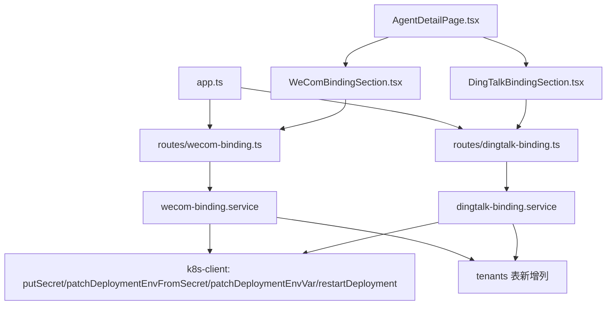

# 企业微信 / 钉钉绑定实现契约（Architect 审查结论）

> 目标：为管理控制台新增「企业微信」「钉钉」两个**凭证填入式**绑定通道（非扫码）。
> 本契约基于对现有 `feishu-binding`（凭证填入式）与 `wechat-binding`（扫码式）的只读审查，
> 给出工程师可直接照做的端点、schema、K8s 操作与前端结构。

---

## 0. 关键结论（TL;DR）

1. **企业微信/钉钉是「凭证填入式」，应照抄 `feishu-binding.ts` 模式，而非 `wechat-binding.ts` 的扫码模式。**
2. 企业微信/钉钉**只允许 `message_plane === 'openclaw'`** 的租户绑定（Agent 侧 `write-config.mjs` 硬性要求）。
3. 每个通道使用**独立的 K8s Secret**（不能复用 `dealclaw-bot-<tenantId>`，因为 `putSecret` 是全量替换，混用会覆盖飞书凭据）。
4. 凭证**不在 provisioning 侧向第三方校验**（飞书会调 `tenant_access_token`，企微/钉钉没有等价的纯服务端校验端点）——只做**格式校验 + 绑定后 Agent 健康检查**兜底。
5. 绑定状态**持久化到 `tenants` 表新增列**（与飞书 `app_id/app_secret` 同模式），不做独立表。

---

## 1. 现有模式回顾（审查确认）

### 1.1 飞书绑定（凭证填入式）— 权威参照

`packages/provisioning-service/src/services/feishu-binding.ts`：

| 步骤 | 函数 | 说明 |
|------|------|------|
| 校验 | `verifyFeishuApp` | POST 飞书 `tenant_access_token` 接口，失败抛 `INVALID_CREDENTIALS` |
| 冲突检查 | `bindTenantFeishuApp` | `SELECT ... WHERE app_id=$1 AND tenant_id<>$2`，防止同一 app 绑两租户 |
| 持久化 | `UPDATE tenants SET app_id, app_secret, platform='feishu'` | 凭据存 tenants 行 |
| Secret | `putSecret(ns, 'dealclaw-bot-<tenantId>', { DEALCLAW_APP_ID, DEALCLAW_APP_SECRET })` | **upsert**（rebind 旋转凭据） |
| envFrom | `patchDeploymentEnvFromSecret(ns, 'dealclaw-agent-<tid>', 'dealclaw-bot-<tid>')` | 幂等补挂 Secret 引用（存量 agent 无该引用时） |
| env pin | `patchDeploymentEnvVar(ns, 'nexus-gateway-<tid>', 'DEALCLAW_MESSAGE_PLANE', 'openclaw')` | 防网关起竞争 WS |
| 滚动 | `restartDeployment(ns, 'dealclaw-agent-<tid>')` | Recreate 策略（scale-0-then-1 语义，无 SQLite 双 pod 争用） |
| 解绑 | `putSecret(... placeholder)` + `restartDeployment` + `UPDATE tenants SET app_id=NULL` | 网关**保留**（LLM 出口代理） |

`packages/provisioning-service/src/services/k8s-client.ts` 关键原语（契约直接用）：
- `putSecret(ns, name, data)` — GET resourceVersion → PUT 全量替换；不存在则 POST 创建。**全量替换语义**。
- `patchDeploymentEnvFromSecret(ns, deployName, secretName)` — 读现有 envFrom 列表，追加重发（envFrom 无 merge key）。
- `patchDeploymentEnvVar(ns, deployName, varName, value)` — env 列表按 `name` 合并，值相同返回 false（no-op）。
- `restartDeployment(ns, deployName)` — `ensureRecreateStrategy` + patch `restarted-at` 注解。

### 1.2 微信绑定（扫码式）— 明确**不采用**

`routes/wechat-binding.ts` + `services/wechat-binding.ts`：QR 登录、Agent bridge 委派、token 存 PVC、`wechat_bindings` 独立表。
**企业微信/钉钉无扫码流程，整套 session/轮询机制不需要。**

### 1.3 路由注册（app.ts L99-101，已确认）

```ts
app.use(createFeishuAppScanRoutes(authAndAudit));   // 飞书扫码取凭据
app.use(createWeChatBindingRoutes(pool, config, authAndAudit)); // 个人微信扫码
```

新增两行：
```ts
app.use(createWeComBindingRoutes(pool, config, authAndAudit));
app.use(createDingTalkBindingRoutes(pool, config, authAndAudit));
```

### 1.4 DB 现状（db/migrate.ts）

- `tenants` 表已有 `app_id, app_secret, message_plane` 等列（`ALTER TABLE ... ADD COLUMN IF NOT EXISTS` 幂等迁移模式，见 L156-159）。
- `wechat_bindings` 表（L428-456）为扫码专用，**不适用于凭证填入式**——不要复用它。

---

## 2. Agent 侧已落地的环境变量契约（write-config.mjs / entrypoint.sh，已上线 commit 6b334f9）

> 这是「通道是否真正启用」的唯一真相来源，provisioning 侧必须精确对齐。

| 通道 | 必须全部满足才启用 | 生成的 channel key | 插件 |
|------|-------------------|-------------------|------|
| 企业微信 | `DEALCLAW_WECOM_BOUND=1` AND `DEALCLAW_MESSAGE_PLANE=openclaw` AND `DEALCLAW_WECOM_BOT_ID`+`DEALCLAW_WECOM_SECRET` 非空 | `channels.wecom` | `@wecom/wecom-openclaw-plugin` (2026.7.2) |
| 钉钉 | `DEALCLAW_DINGTALK_BOUND=1` AND `DEALCLAW_MESSAGE_PLANE=openclaw` AND `DEALCLAW_DINGTALK_CLIENT_ID`+`DEALCLAW_DINGTALK_CLIENT_SECRET` 非空 | `channels.dingtalk-connector` | `@dingtalk-real-ai/dingtalk-connector` (0.8.25) |

**关键差异**：
- 企业微信：`write-config.mjs` 里 `secret: wecomSecret` 是**明文字符串**（插件 2026.7.2 不支持 SecretRef），`openclaw.json` 以 0600 写入。
- 钉钉：`clientSecret: { source: 'env', ... id: 'DEALCLAW_DINGTALK_CLIENT_SECRET' }` 是 **env SecretRef**。
- 两者都是 `dmPolicy: 'open'`、`allowFrom: ['*']`、`groupPolicy: 'open'`。

**推论**：绑定流程必须同时注入「BOUND 开关 env」和「凭证 Secret」，并重启 agent 使 `write-config.mjs` 在启动时重读。

---

## 3. 实现契约

### 3.1 provisioning-service 路由文件结构

新增两个路由文件（与 `wechat-binding.ts` 同风格：独立 Router 工厂，注入 `pool/config/authMiddleware`）。

#### `routes/wecom-binding.ts`

| 方法 | 路径 | 请求 body | 响应 |
|------|------|-----------|------|
| GET | `/v1/admin/tenants/:tenantId/wecom-binding` | — | `{ ok:true, tenantId, bound:boolean, botId:string\|null, status:string, boundAt:string\|null, lastError:string\|null }` |
| PUT | `/v1/admin/tenants/:tenantId/wecom-binding` | `{ botId:string, secret:string }` | `{ ok:true, tenantId, botId, restarted:boolean, message:string }` |
| DELETE | `/v1/admin/tenants/:tenantId/wecom-binding` | — | `{ ok:true, restarted:boolean }` |

#### `routes/dingtalk-binding.ts`

| 方法 | 路径 | 请求 body | 响应 |
|------|------|-----------|------|
| GET | `/v1/admin/tenants/:tenantId/dingtalk-binding` | — | `{ ok:true, tenantId, bound:boolean, clientId:string\|null, status:string, boundAt:string\|null, lastError:string\|null }` |
| PUT | `/v1/admin/tenants/:tenantId/dingtalk-binding` | `{ clientId:string, clientSecret:string }` | `{ ok:true, tenantId, clientId, restarted:boolean, message:string }` |
| DELETE | `/v1/admin/tenants/:tenantId/dingtalk-binding` | — | `{ ok:true, restarted:boolean }` |

**错误契约**（与 `wechat-binding.ts`/`feishu-binding.ts` 一致）：
- `400 TENANT_DESTROYED` — 租户已销毁
- `400 INVALID_INPUT` — 缺少字段/格式错
- `400 PLANE_MISMATCH` — `message_plane !== 'openclaw'`
- `409 CREDENTIAL_CONFLICT` — 同一 botId/clientId 已绑到别的租户
- `404 NOT_FOUND` / `404 NOT_BOUND`

> 重新绑定采用 **PUT 覆盖（旋转凭据）**，与飞书一致，不返回 `ALREADY_BOUND`（同通道已绑定时 PUT 即换绑）。

### 3.2 K8s Secret 创建与 env patch 的确切方式

#### 企业微信

```ts
const ns = tenant.k8s_namespace || config.runtimeNamespace;
const agentName = `dealclaw-agent-${tenantId}`;
const secretName = `dealclaw-wecom-${tenantId}`;

await putSecret(ns, secretName, {
  DEALCLAW_WECOM_BOT_ID: botId,
  DEALCLAW_WECOM_SECRET: secret,
});
await patchDeploymentEnvFromSecret(ns, agentName, secretName);        // 幂等补挂 Secret 引用
await patchDeploymentEnvVar(ns, agentName, 'DEALCLAW_WECOM_BOUND', '1');   // 开开关
await patchDeploymentEnvVar(ns, agentName, 'DEALCLAW_MESSAGE_PLANE', 'openclaw'); // 幂等兜底
```

#### 钉钉

```ts
const secretName = `dealclaw-dingtalk-${tenantId}`;

await putSecret(ns, secretName, {
  DEALCLAW_DINGTALK_CLIENT_ID: clientId,
  DEALCLAW_DINGTALK_CLIENT_SECRET: clientSecret,
});
await patchDeploymentEnvFromSecret(ns, agentName, secretName);
await patchDeploymentEnvVar(ns, agentName, 'DEALCLAW_DINGTALK_BOUND', '1');
await patchDeploymentEnvVar(ns, agentName, 'DEALCLAW_MESSAGE_PLANE', 'openclaw');
```

**为什么独立 Secret**：`putSecret` 是全量替换（GET resourceVersion → PUT），若复用 `dealclaw-bot-<tenantId>` 会把飞书的 `DEALCLAW_APP_ID/_SECRET` 抹掉。必须独立。

### 3.3 绑定 / 解绑的 deployment patch 流程

#### 绑定（PUT）

```
1. 读 tenant（status/k8s_namespace/message_plane/agent_endpoint）
2. 校验: 存在 && status !== 'destroyed' && message_plane === 'openclaw'
3. 格式校验: botId/clientId 非空、secret/clientSecret 非空且 8<=len<=128
4. 冲突检查: SELECT tenant_id FROM tenants WHERE <cred_id_col>=$1 AND tenant_id<>$2 AND status<>'destroyed'
5. UPDATE tenants SET <cred cols>, bound_at=NOW()          （先落库，dry-run 也能查状态）
6. if !config.k8sDryRun && tenant.k8s_namespace:
     putSecret(...)                                        upsert 凭证
     patchDeploymentEnvFromSecret(...)                     补挂 Secret 引用
     patchDeploymentEnvVar(..._BOUND, '1')                 开开关
     patchDeploymentEnvVar(MESSAGE_PLANE, 'openclaw')      幂等兜底
     restartDeployment(ns, agentName)                      滚动（Recreate）
     轮询 agent /healthz（max ~3min，复用微信 36×5s 逻辑）
     restarted = true
7. INSERT tenant_status_log（绑定审计）
8. 返回 { ok, restarted, message }
```

#### 解绑（DELETE）

```
1. 读 tenant，校验存在 + 已绑定（cred_id 列非空）
2. UPDATE tenants SET <cred cols>=NULL, bound_at=NULL       先落库
3. if !config.k8sDryRun && tenant.k8s_namespace:
     putSecret(ns, secretName, { <CRED_ID>: 'placeholder-<tid>', <SECRET>: uuidv4() })  旋转占位
     patchDeploymentEnvVar(ns, agentName, '<...>_BOUND', '0')                            关开关
     restartDeployment(ns, agentName)                                                    滚动丢 channel
4. INSERT tenant_status_log（解绑审计）
5. 返回 { ok, restarted }
```

> 解绑**不删 Secret、不删 agent、不删 gateway**。Secret 旋转为占位 + BOUND=0 后，`write-config.mjs` 的 `wecomBound/dingtalkBound` 为 false，通道自然下线。网关是 LLM 出口代理，必须保留（与飞书/微信解绑一致）。

### 3.4 凭证格式校验（无第三方校验端点，只能本地规则）

- 企业微信：`botId` 非空、`secret` 非空且 `8 <= len <= 128`。
- 钉钉：`clientId` 非空、`clientSecret` 非空且 `8 <= len <= 128`。
- **不调第三方校验**（飞书的 `tenant_access_token` 等价物在企微/钉钉侧需要 appsecret 换 token 或回调，provisioning 侧不具备完整上下文）。错误凭据会在 agent 启动后表现为通道未就绪——可接受兜底，需在 UI hint 说明「凭据错误将导致绑定后通道不可用」。

### 3.5 DB 迁移（db/migrate.ts 追加，幂等）

```sql
ALTER TABLE tenants ADD COLUMN IF NOT EXISTS wecom_bot_id TEXT;
ALTER TABLE tenants ADD COLUMN IF NOT EXISTS wecom_secret TEXT;
ALTER TABLE tenants ADD COLUMN IF NOT EXISTS wecom_bound_at TIMESTAMPTZ;
ALTER TABLE tenants ADD COLUMN IF NOT EXISTS dingtalk_client_id TEXT;
ALTER TABLE tenants ADD COLUMN IF NOT EXISTS dingtalk_client_secret TEXT;
ALTER TABLE tenants ADD COLUMN IF NOT EXISTS dingtalk_bound_at TIMESTAMPTZ;
```

> 冲突检查用 `wecom_bot_id` / `dingtalk_client_id` 列做 `tenant_id<>$2` 查询（复用飞书 `app_id` 冲突模式）。飞书未做部分唯一索引，本契约保持一致（不做，避免引入复杂度）。

### 3.6 service 层文件

新增 `services/wecom-binding.ts`、`services/dingtalk-binding.ts`，各导出：
- `getTenantWeComBinding(pool, tenantId)` / `getTenantDingTalkBinding(...)`
- `bindTenantWeCom(pool, config, tenantId, { botId, secret })` / `bindTenantDingTalk(...)`
- `unbindTenantWeCom(pool, config, tenantId)` / `unbindTenantDingTalk(...)`
- `WeComBindingError` / `DingTalkBindingError`（`{status, code, message}`，与 `WeChatBindingError` 同型）

> 建议两个通道抽共享 `services/enterprise-binding-common.ts` 存 `getTenantRow` / `resolveAgentEndpoints` / 健康轮询等公共 helper。但为保持与飞书/微信两个 service 完全独立、减少跨文件耦合，**工程师可选择不抽公共层**（各自独立实现更直接，符合现有代码库风格）。契约上不强求。

---

## 4. admin-web 前端结构

### 4.1 新增组件（凭证填入式，**无扫码弹窗**）

- `components/WeComBindingSection.tsx` — 自管理状态（仿 `WeChatBindingSection`，但用输入框而非扫码按钮）
- `components/DingTalkBindingSection.tsx` — 同上

区块结构（每个组件内部）：
```
section-title: 企业微信绑定 / 钉钉绑定
panel
  form-row[当前状态]  → badge（已绑定/未绑定）+ botId/clientId 截断 + 解绑按钮
  form-row[输入框]    → 两个输入框（凭证字段1 + 凭证字段2 type=password）+ 绑定按钮
  hint                → 说明：仅支持 openclaw 平面租户；凭据错误会导致绑定后通道不可用
```

### 4.2 AgentDetailPage.tsx 集成

- 在 `WeChatBindingSection`（L1963-2066）之后新增 `<WeComBindingSection .../>`、`<DingTalkBindingSection .../>`。
- 状态接口：
  ```ts
  interface WeComBindingInfo { ok:true; bound:boolean; botId:string|null; status:string; boundAt:string|null; lastError:string|null }
  interface DingTalkBindingInfo { ok:true; bound:boolean; clientId:string|null; status:string; boundAt:string|null; lastError:string|null }
  ```
- 绑定调用：`api('/v1/admin/tenants/:tid/wecom-binding', { method:'PUT', body:{botId, secret} })`
- 解绑调用：`api('/v1/admin/tenants/:tid/wecom-binding', { method:'DELETE' })`（confirm 文案）

> 不需要 `WeChatScanModal` / `FeishuAppScanModal` 那类轮询弹窗。前端只是一个普通表单。

---

## 5. 与现有飞书/微信绑定的差异点

| 维度 | 飞书（feishu-binding） | 个人微信（wechat-binding） | 企业微信/钉钉（本契约） |
|------|----------------------|--------------------------|------------------------|
| 交互方式 | 凭证填入 + 扫码取凭据 | 扫码轮询 | **纯凭证填入，无扫码** |
| 第三方校验 | ✅ `tenant_access_token` | ❌（Agent 内 QR） | ❌ 仅本地格式校验 + 绑定后健康检查 |
| 凭据存储 | tenants 行 + `dealclaw-bot-<tid>` Secret | PVC state 目录 + `wechat_bindings` 表 | tenants 行 + **独立 per-channel Secret** |
| 启用开关 env | `DEALCLAW_MESSAGE_PLANE=openclaw` | `DEALCLAW_WECHAT_BOUND=1` | `DEALCLAW_WECOM_BOUND=1` / `DEALCLAW_DINGTALK_BOUND=1` |
| 平面限制 | 兼容 gateway / openclaw 两平面 | 仅 openclaw | **仅 openclaw（硬性）** |
| Secret 引用 | `patchDeploymentEnvFromSecret` 挂 agent | 无（token 在 PVC） | `patchDeploymentEnvFromSecret` 挂 agent |
| 滚动目标 | openclaw→agent；gateway→gateway | agent | **始终 agent** |
| 解绑 | 占位凭据 + 滚动，网关保留 | 清 PVC + 滚动 | 占位凭据 + BOUND=0 + 滚动，网关保留 |

---

## 6. 风险与注意事项

1. **`putSecret` 全量替换语义**（最高风险）：绝不能复用 `dealclaw-bot-<tenantId>`，否则覆盖飞书凭据。必须用 `dealclaw-wecom-<tid>` / `dealclaw-dingtalk-<tid>` 独立 Secret。
2. **平面硬限制**：`message_plane !== 'openclaw'` 时绑定必然无效（write-config 直接不启用 channel）。**PUT 前必须校验并返回明确错误**，否则管理员会「绑定成功但通道不工作」。前端 hint 也要说明。
3. **envFrom patch 的容器名匹配**：`patchDeploymentEnvFromSecret` 内部 `containers.find(c => c.name === deployName)`——即**容器名必须等于 Deployment 名** `dealclaw-agent-<tid>`。这是现有约定（createDeployment 里 `name: spec.name`），新增代码沿用即可，但不要在容器里改名。
4. **健康检查兜底**：企业微信/钉钉无第三方校验，错误凭据会导致 agent 起不来或 channel 未就绪。绑定后必须轮询 `/healthz`（复用微信 36×5s 逻辑），超时抛 `AGENT_NOT_READY`，并在 UI 提示「如通道不可用请检查凭据」。
5. **Rebind（PUT 覆盖）**：与飞书一致，允许同通道 PUT 旋转凭据。但跨租户冲突（同一 botId 绑两租户）必须 `409` 拦截，防止两 agent 抢同一 bot 的 WS 长连接。
6. **解绑顺序**：先 `UPDATE tenants` 清库，再 `putSecret(placeholder)` + `BOUND=0` + restart。若 restart 失败，库已清但 Secret 仍是旧值——下次启动仍可能短暂启用。可接受（与飞书一致），但 `tenant_status_log` 需记录真实结果。
7. **企业微信 secret 明文落地**：`write-config.mjs` 把 `secret` 作为字符串写入 `openclaw.json`（0600）。这是插件版本限制，属既定设计；K8s Secret 侧仍用 `putSecret` 存 base64，符合最小暴露原则。
8. **不要复用 `wechat_bindings` 表**：那是扫码 session 生命周期专用（validating/bound/active/disabling 状态机），凭证填入式直接走 tenants 列，避免状态机语义错配。
9. **dry-run 兼容**：`config.k8sDryRun` 为 true 时跳过全部 K8s 调用，但仍要 `UPDATE tenants` + `tenant_status_log`，保证本地/测试可观察状态流转（飞书/微信同款约定）。

---

## 7. 依赖图（Mermaid）


