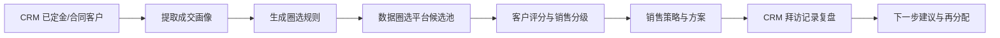

# 米奥数据圈选平台 + CRM：销售分配与拜访质量判断模拟案例

> ✅ **结论先行**：本案例用 CRM 已成交/定金客户「广州市欣婷生物科技有限公司」做样本，模拟完成「成交画像校准 → 数据圈选 → 销售分级分配 → 销售策略/方案 → 拜访质量复盘」闭环。当前为只读模拟，不写入 CRM 或数据圈选平台。

## 1. 客户最终需求拆解

客户希望 V 学习数据圈选平台和 CRM，不只是为了查数据，而是为了形成可服务销售管理的闭环系统。

| 需求 | V 的模拟能力 | 本案例是否覆盖 |
|---|---|---|
| 通过 CRM 已定金/合同客户画像，从数据圈选平台圈选数据 | 从 CRM 抽取成交客户特征，再转成圈选规则 | 已覆盖 |
| 根据国外目标市场热销品分析圈选客户 | 把目标市场、展会、产品关键词转成候选池规则 | 已模拟 |
| 圈选后制定销售策略 | 按客户潜力、匹配度、销售难度给销售动作 | 已覆盖 |
| 根据背调和市场情况制定销售方案 | 合并 CRM 销售温度与数据圈选外贸画像 | 已覆盖 |
| 根据拜访记录判断是否高质量拜访，给下一步建议 | 读取 CRM 会议/拜访字段，按关键问题和推进结果评分 | 已覆盖 |

## 2. 本次模拟样例

### 2.1 样例客户

| 字段 | 内容 |
|---|---|
| 客户名称 | 广州市欣婷生物科技有限公司 |
| CRM 客户级别 | 定金老客户 |
| CRM 是否成交 | 是 |
| CRM 主营产品 | 洗衣凝珠、洗涤用品 |
| CRM 关联商机数量 | 3 |
| 数据圈选行业 | 家电3C |
| 数据圈选最近参展 | 2026年第十六届中国（波兰）出口品牌联展 |
| 数据圈选贸易记录 | 15 条 |
| 数据圈选产品标签 | 家电3C / 家用电器 / 空气质量电器 / 香薰机 |

### 2.2 CRM 证据

| 类型 | 证据 | 业务含义 |
|---|---|---|
| 赢单商机 | 2026 波兰出口品牌联展，阶段：赢单，金额约 48040 | 波兰市场已被验证，有成交基础 |
| 签约商机 | 2026 AES 波兰家用电器及消费电子展，阶段：签约，金额约 46780 | 同一市场/相邻展会有复购或交叉销售潜力 |
| 在谈商机 | 2026 印尼国际家居礼品展，阶段：谈判 | 可作为下一步市场扩展方向 |
| 合同记录 | 3 条合同/订单记录，其中波兰已有赢单/签约，印尼处于商务谈判 | 可用于定义“已定金/合同客户画像” |
| 拜访记录 | 3 条拜访/会议记录，最近一次为 2026-05-11 初访 | 可用于判断拜访质量与下一步动作 |

## 3. 模拟闭环流程

## 4. 成交画像校准

本案例先把「广州市欣婷」作为正样本，不直接拿它去复制名单，而是提炼一组可解释画像。

| 画像维度 | 本案例特征 | 可转成的圈选条件 |
|---|---|---|
| 产品 | 洗衣凝珠、洗涤用品；数据圈选标签显示家电3C/家用电器相邻类目 | 家电、家居、清洁用品、个护清洁、消费品 |
| 市场 | 波兰已有赢单/签约；印尼处于谈判 | 优先波兰，其次印尼/东南亚 |
| 展会 | 波兰出口品牌联展、AES 波兰家用电器及消费电子展、印尼家居礼品展 | 关联展会、相邻展区、同项目客户 |
| 销售阶段 | 已有赢单、签约、谈判三类状态 | 区分强复购、交叉销售、培育客户 |
| 销售人员 | 已有明确 owner 与销售人员 | 同类客户优先给熟悉该行业/市场的销售 |

> 📌 **模拟结论**：第一版画像不应写成“家电3C”这么粗，而应写成「清洁/家居消费品 + 波兰已成交 + 家电/消费电子展会场景 + 可向印尼扩展」。

## 5. 数据圈选模拟

### 5.1 圈选规则设计

| 规则层级 | 条件 | 用途 |
|---|---|---|
| 强匹配 | 产品关键词：洗涤用品 / 清洁用品 / 家居消费品；市场：波兰；有参展记录 | 优先给高级销售，做高价值跟进 |
| 中匹配 | 产品关键词：家电 / 家居 / 个护；市场：欧洲或东南亚；有外贸/官网/展会任一证据 | 给成熟销售做培育 |
| 弱匹配 | 仅命中宽泛关键词，例如“美容”但结果出现汽车美容等噪声 | 进入数据清洗，不直接分配 |

### 5.2 本次实际试跑观察

| 试跑规则 | 观察 | 处理建议 |
|---|---|---|
| 美容/个护关键词 | 首批结果出现大量“汽车美容”噪声 | 不能直接分配；需要增加行业排除词或产品层级限制 |
| 家电关键词 | 能出现家电3C类候选，部分有参展记录 | 可作为中匹配候选池 |
| 广东 + 美容关键词 | 地域收窄但仍需清洗语义噪声 | 适合做第二轮过滤，不适合作为最终规则 |

> ❗ **重要**：不能把关键词搜索结果直接分配给销售。必须先做样本校验，尤其要处理“美容=汽车美容”这种语义噪声，否则名单会歪。

## 6. 销售分级分配模拟

| 客户类型 | 评分区间 | 分配对象 | 动作建议 |
|---|---:|---|---|
| A 类：高度相似成交画像 | 80+ | 高级销售 / 已成交 owner / 行业熟手 | 直接用成交案例切入，约二访或方案会 |
| B 类：产品或市场匹配，但证据不完整 | 60-79 | 成熟销售 | 先做诊断式触达，补齐市场、产品、预算、展会计划 |
| C 类：宽泛命中或噪声高 | 40-59 | 运营池 / SDR / 数据清洗 | 不直接推给核心销售，先清洗和二次验证 |
| D 类：明显不匹配 | <40 | 暂不分配 | 保留为负样本，优化圈选规则 |

### 6.1 本案例的分配建议

| 对象 | 判断 | 建议 |
|---|---|---|
| 广州市欣婷 | A 类复购/扩展客户；波兰已成交，印尼在谈 | 由原 owner 或熟悉波兰/印尼家居消费品项目的高级销售跟进 |
| 家电关键词候选池 | B 类候选；需继续验证产品和目标市场 | 给成熟销售小批量试跑，每人 5-10 条 |
| 美容关键词噪声池 | C/D 类；首批出现汽车美容 | 先交给数据清洗，不进入销售分配 |

## 7. 销售策略与销售方案

### 7.1 对广州市欣婷的策略

- **核心判断**：这不是冷启动客户，而是已成交/签约/在谈并存的复购型客户。
- **销售切入**：不要从“要不要继续参展”切入，而要从“波兰已验证后，如何复制到印尼/东南亚”切入。
- **方案主题**：波兰成交复盘 + 印尼市场试点 + 家居清洁用品海外获客素材包。
- **星擎/AI 服务切入**：把洗衣凝珠、洗涤用品做成多语种卖点、短视频脚本、展后跟进话术和买家分层清单。

### 7.2 一页方案结构

| 章节 | 内容 |
|---|---|
| 客户现状 | 波兰已有赢单/签约，印尼商机谈判中；产品为洗衣凝珠、洗涤用品 |
| 市场判断 | 波兰可作为已验证市场，印尼作为下一步扩展市场 |
| 增长假设 | 同类产品可复制到家居/清洁用品展会场景；展后线索需要素材和跟进脚本提升转化 |
| 试点动作 | 选 3 个主推产品，生成波兰/印尼双语素材、买家跟进话术和销售问答 |
| 验证指标 | 二访约成率、方案接受度、客户提供素材完整度、展后线索转化反馈 |

## 8. 拜访质量判断模拟

CRM 会议模块显示该客户有 3 条拜访记录。当前字段能看到拜访目的、拜访状态、签到签退、拜访内容和小结。由于拜访小结为空，质量判断要保守。

| 拜访 | 系统记录 | 质量判断 | 原因 |
|---|---|---|---|
| 2026-05-11 初访 | 已拜访；内容 S1/S2；签到正常；签退异常；无拜访小结 | B-/C+ | 有到访证据，但缺少小结和下一步动作，签退异常需核查 |
| 2025-04-10 初访 | 已拜访；签到正常；无内容；无小结 | C | 只有到访，不足以证明高质量拜访 |
| 2025-03-07 初访 | 已拜访；签到/签退正常；无内容；无小结 | C+ | 流程完整，但缺少客户需求、异议、下一步 |

### 8.1 高质量拜访判定标准

| 维度 | 高质量标准 | 本案例缺口 |
|---|---|---|
| 客户需求 | 记录目标市场、主推产品、当前痛点 | 小结为空，未沉淀需求 |
| 销售推进 | 记录下一步会议、报价、方案、资料清单 | 下一步动作缺失 |
| 关键人 | 记录决策人/使用人/联系人角色 | 需要关联 Contacts 补齐 |
| 证据完整 | 签到签退正常，有拜访内容和小结 | 部分签退异常，内容不足 |
| 业务结果 | 拜访后推进到商机/合同/复购 | 该客户后续有商机和合同，可作为结果加分 |

> 📝 **下步建议**：对最近一次 2026-05-11 拜访做补录：客户目标市场、印尼项目意向、主推产品、预算/展位计划、是否接受星擎素材试点、下一步时间。补录后该拜访才可从 B-/C+ 上调为 B+ 或 A-。

## 9. 本案例给客户看的结论

1. CRM 能告诉我们：哪些客户已经定金/合同、谁在跟、成交/签约/谈判处于什么阶段。
2. 数据圈选平台能告诉我们：客户外贸画像、行业标签、参展记录、贸易活跃度，以及可扩展的相似客户池。
3. V 的价值不是查表，而是把两边数据变成销售动作：圈选规则、客户评分、分级分配、拜访建议和销售方案。
4. 正式上线前必须先做样本校验，尤其要校验关键词噪声、行业口径、销售人员分布和现有系统结果是否一致。
5. 拜访质量不能只看“已拜访”，必须看是否记录需求、异议、关键人、下一步和业务结果。

## 10. 下一步落地计划

| 步骤 | 动作 | 产出 |
|---|---|---|
| 1 | 抽 10-30 个 CRM 已定金/合同客户 | 成交画像样本集 |
| 2 | 用数据圈选平台补全工商、贸易、参展、产品标签 | 成交画像字段矩阵 |
| 3 | 生成 3-5 套圈选规则，并抽样校验噪声 | 可用圈选规则库 |
| 4 | 按 A/B/C/D 分级分配给不同销售 | 销售分配建议表 |
| 5 | 为每类客户生成销售策略、方案和二访提纲 | 销售作战包 |
| 6 | 读取会议/拜访记录做质量判断 | 拜访复盘与下一步建议 |

---

**安全说明**：本文档不包含 refresh token、access token、client secret、客户联系方式明细。所有接口调用均为只读模拟。
